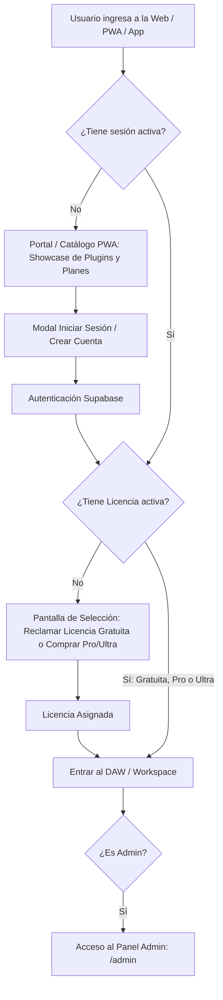

# Especificación de Arquitectura: Gatekeeper PWA, Control de Acceso por Licencia y Usuario Admin

**Objetivo:** Transformar el acceso al DAW en una experiencia segura basada en membresías. Ningún usuario anónimo puede acceder directamente al lienzo de trabajo del DAW. En su lugar, se presenta un **Portal / Catálogo PWA** con estética Cyber donde se exhiben los plugins, los planes de licencia (**Gratuita**, **Pro**, **Ultra**), la autenticación de usuarios y el acceso al DAW condicionado a tener una licencia activa.

---

## 1. Flujo de Navegación y Control de Acceso (Gatekeeper)



---

## 2. Definición de Niveles de Licencia (Tiers)

| Nivel | Costo | Acceso al DAW | Plugins y Funcionalidades Incluidas |
|---|---|---|---|
| **Gratuita (Free)** | $0 / Gratis | Acceso completo al DAW web y escritorio | EQ 4 bandas, Compresor estándar, Utilidad básica, Sintetizador Piano con 16 voces, exportación estéreo WAV/MP3. |
| **Pro** | Mensual / Pago | Acceso completo + Guardado en la nube | EQ 8 bandas quirúrgico, Compresión paralela y Sidechain HPF, True-Peak Limiter a 8x, Smart De-Esser, 32 voces de sintetizador, sincronización multi-dispositivo. |
| **Ultra** | Suite Completa | Acceso ilimitado + MasterPass | Suite VST3 nativa completa (descarga para Reaper/Ableton/FL Studio), True-Peak Limiter 16x con LUFS EBU R128, De-Esser Split-band, Roles Synthesizer con los 13 roles de producción desbloqueados, IA ilimitada. |

---

## 3. Asignación de tu Usuario como Administrador (Admin)

El backend de JasWave valida el rol de administrador en cada petición mediante la tabla `Usuario` en Supabase PostgreSQL (`esAdmin = true`).

### Paso para otorgarte rol Admin en Supabase:
1. Regístrate con tu correo en la aplicación web o crea el usuario en **Supabase Auth → Users**.
2. Abre el **SQL Editor** de Supabase y ejecuta:

```sql
-- Convierte tu usuario registrado en Administrador Global
UPDATE "Usuario"
SET "esAdmin" = true
WHERE "email" = 'TU_CORREO_AQUI@ejemplo.com';
```

Al iniciar sesión con ese correo:
* Tu token JWT y la llamada a `GET /auth/me` devolverán `esAdmin: true`.
* Tendrás acceso al panel maestro de administración en el DAW (`jas-wave/components/admin/PanelAdmin.tsx`) para:
  1. Asignar licencias Pro/Ultra manualmente a cualquier usuario por su correo.
  2. Revocar o suspender licencias.
  3. Auditar dispositivos vinculados a los VSTs en Reaper.

---

## 4. Componentes a Implementar en el Frontend (`jas-wave`)

### 4.1 Nuevo Estado de Puerta de Entrada en `App.tsx`
Modificar el componente raíz para condicionar la carga del workspace del DAW:

```tsx
export function App() {
  const { session, identidad, cargando } = useSesion();
  const [mostrarDaw, setMostrarDaw] = useState(false);

  if (cargando) {
    return <PantallaCargaCyber />;
  }

  // Si no ha iniciado sesión o no ha presionado "Entrar al DAW":
  if (!session || !mostrarDaw) {
    return (
      <PortalCatalogoPWA
        sesion={session}
        identidad={identidad}
        onEntrarAlDaw={() => {
          if (!session) {
            abrirModalAuth();
          } else if (tieneLicencia(identidad)) {
            setMostrarDaw(true);
          } else {
            abrirModalPlanes();
          }
        }}
      />
    );
  }

  // Usuario autenticado y con licencia: Renderizar el DAW
  return <WorkspaceDaw identidad={identidad} onVolverAlPortal={() => setMostrarDaw(false)} />;
}
```

### 4.2 El Portal / Catálogo PWA (`PortalCatalogoPWA.tsx`)
Una interfaz moderna con estética Cyber construida con los tokens de JasWave:
1. **Cabecera (Header):**
   * Logo JasWave con brillo cian.
   * Botón de "Iniciar Sesión" / "Mi Cuenta" con avatar.
   * Insignia `[ADMIN]` con acceso directo al Panel de Control si `identidad.esAdmin == true`.
2. **Hero:**
   * Título futurista: *"JasWave Studio — La Próxima Generación de Creación Musical"*.
   * Botón de llamado a la acción (CTA): **"Entrar al Estudio"**.
3. **Catálogo de Plugins (Showcase Interactivo):**
   * Tarjetas Cyber con marco metálico para los 7 plugins (`Param-EQ`, `Bus Compressor`, `TruePeak Limiter`, `Smart De-Esser`, `Utility`, `Piano Synth`, `Roles Synth`).
   * Pestaña con previsualizaciones de la curva de ecualización y medidores en vivo.
4. **Tabla de Planes (Pricing / Membership):**
   * Tarjeta **Gratuita**: Botón "Comenzar Gratis" (asigna licencia Free automáticamente a la cuenta).
   * Tarjeta **Pro**: Botón "Suscribirse".
   * Tarjeta **Ultra**: Botón "Obtener Suite Completa".

---

## 5. Integración con el Sistema de Licencias de los VST3

Cuando un usuario descargue y use los plugins en DAWs externos (como Reaper):
1. El usuario hace clic en **"INICIAR SESIÓN"** dentro del plugin en Reaper.
2. El plugin abre el navegador en `https://app.jaswave.com/activar?codigo=XXXX`.
3. El portal web detecta la sesión del usuario.
4. Si el usuario tiene licencia **Gratuita**, **Pro** o **Ultra**, el botón **"Aprobar Plugin"** emite el token firmado con las features permitidas para su nivel.
5. El plugin en Reaper se desbloquea al instante en segundo plano.
