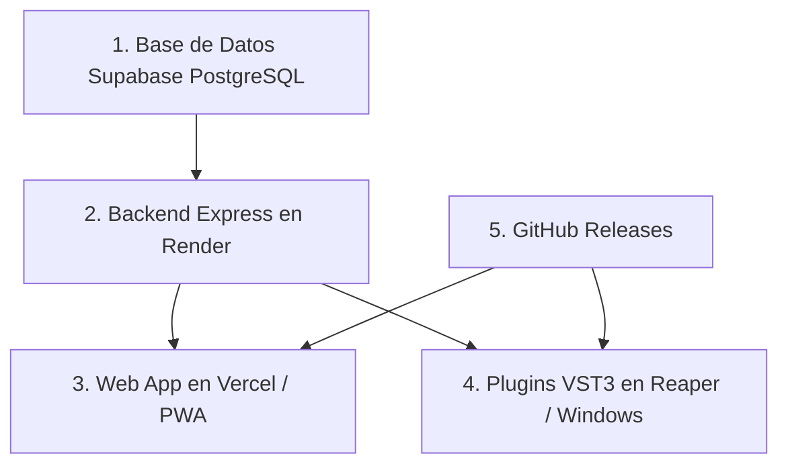

# Guía Maestra de Despliegue en Producción y Activación de VSTs — JasWave

Esta guía detalla paso a paso la arquitectura, orden de dependencias, configuración de servicios en la nube (**Supabase**, **Render**, **Vercel**), el repositorio de **GitHub Releases** para la descarga de los VSTs y módulos, el alta del **Super Administrador**, y la vinculación con los plugins VST3 nativos en Windows/Reaper.

---

## 1. Credenciales y Configuración del Super Administrador

Para gestionar el catálogo, asignar licencias Ultra/Pro y auditar dispositivos, se ha definido el siguiente usuario Super Admin:

* **Correo:** `jaswave.audio@gmail.com`
* **Contraseña inicial:** `P0pok@tepel01`
* **Rol:** `esAdmin: true` (Permisos globales en API y DAW)

### 1.1 Creación del Usuario en Supabase Auth
1. Ingresa a tu panel de **Supabase → Authentication → Users**.
2. Haz clic en **Add User → Create User**:
   * **Email:** `jaswave.audio@gmail.com`
   * **Password:** `P0pok@tepel01`
   * **Auto Confirm User:** Marcar casilla en **Yes** (para evitar confirmación de email inicial).

### 1.2 Registro Automático en Base de Datos (Prisma)
Desde la terminal en `backend/`:
```bash
npm run admin:seed
```
Este script:
1. Registra al usuario en la tabla `Usuario` con el flag `"esAdmin": true`.
2. Siembra automáticamente los 7 plugins oficiales de JasWave.
3. Otorga al Super Admin licencias activas permanentes para todos los plugins.

---

## 2. Configuración de GitHub: Almacén de Descargas de VSTs y Módulos (.jwx)

El DAW y el catálogo web descargan los paquetes binarios firmados desde **GitHub Releases**. Los plugins nativos y módulos web se empaquetan con la extensión **`.jwx`** (formato zip firmado con SHA-256).

### 2.1 Repositorio y Etiqueta de Releases
* **Repositorio oficial:** `JASBOOTSTUDIOS/jaswaveaudio`
* **Tag oficial de Plugins:** `plugins-v1.0.0`
* **Estructura de descarga del manifiesto:**
  ```text
  https://github.com/JASBOOTSTUDIOS/jaswaveaudio/releases/download/plugins-v1.0.0/<paquete>-1.0.0.jwx
  ```

### 2.2 Paquetes de los 7 Plugins VST3 Nativos

| Binario | Paquete .jwx para GitHub Releases | Contenido |
|---|---|---|
| `JasWaveParamEq.vst3` | `com.jaswave.plugin.param-eq-1.0.0.jwx` | VST3 + manifiesto + layouts |
| `JasWaveBusCompressor.vst3` | `com.jaswave.plugin.bus-compressor-1.0.0.jwx` | VST3 + manifiesto + layouts |
| `JasWaveTruePeakLimiter.vst3` | `com.jaswave.plugin.truepeak-limiter-1.0.0.jwx` | VST3 + manifiesto + layouts |
| `JasWaveSmartDeEsser.vst3` | `com.jaswave.plugin.smart-deesser-1.0.0.jwx` | VST3 + manifiesto + layouts |
| `JasWaveUtility.vst3` | `com.jaswave.plugin.utility-tool-1.0.0.jwx` | VST3 + manifiesto + layouts |
| `JasWavePiano.vst3` | `com.jaswave.plugin.piano-synth-1.0.0.jwx` | VST3 + manifiesto + layouts |
| `JasWaveRoles.vst3` | `com.jaswave.plugin.roles-vst-1.0.0.jwx` | VST3 + manifiesto + layouts |

### 2.3 Cómo Compilar, Empaquetar y Subir los VST3 a GitHub Releases
Desde PowerShell en la raíz del proyecto:

1. **Compilar los plugins C++:**
   ```powershell
   cmake -S plugins -B plugins/build -A x64
   cmake --build plugins/build --config Release --parallel
   ```

2. **Empaquetar y firmar las extensiones `.jwx`:**
   ```powershell
   # Empaqueta y firma cada plugin con el script oficial
   node plugins/scripts/firmar-jwx.mjs plugins/com.jaswave.plugin.bus-compressor --api http://127.0.0.1:8787
   ```

3. **Crear el Release en GitHub con GitHub CLI (`gh`):**
   ```powershell
   # Autenticar GitHub CLI si no lo has hecho
   gh auth login

   # Crear la release con el tag plugins-v1.0.0
   gh release create plugins-v1.0.0 `
     --repo JASBOOTSTUDIOS/jaswaveaudio `
     --title "JasWave Plugins Suite v1.0.0" `
     --notes "Suite oficial de 7 plugins VST3 nativos con diseño Cyber unificado." `
     plugins/dist/*.jwx
   ```

Al publicar este Release, el catálogo del DAW podrá descargar e instalar automáticamente cualquier plugin con un solo clic.

---

## 3. Mapa de Dependencias del Ecosistema



| Nivel | Componente | Plataforma | Función |
|---|---|---|---|
| **1** | Base de Datos & Auth | **Supabase** (PostgreSQL) | Almacén de usuarios, productos, licencias, sesiones y auditoría. |
| **2** | API de Licencias & Sync | **Render** (Node.js) | Emisión de tokens Ed25519, validación de device-code y WebSocket de sync. |
| **3** | Portal Web de JasWave | **Vercel** (Vite / React) | Portal PWA, login de usuarios y pantalla de aprobación `/activar?codigo=...`. |
| **4** | Repositorio de Binarios | **GitHub Releases** | Hospedaje y distribución de archivos `.jwx` versionados. |
| **5** | Plugins VST3 | **Windows / Reaper** | Consumen el API, reciben el token firmado y desbloquean el audio. |

---

## 4. Paso a Paso: Configuración de la Base de Datos en Supabase

### 4.1 Crear Proyecto en Supabase
1. Ingresa a [supabase.com](https://supabase.com).
2. Crea un nuevo proyecto:
   * **Project Name:** `jaswave-production`
   * **Database Password:** Guarda la contraseña.
3. En **Project Settings → Database**, copia el **Connection String** (Transaction Pooler en puerto 6543 o Direct en 5432).
4. En **Project Settings → API**, copia `Project URL`, `anon public key` y `service_role secret key`.

### 4.2 Despliegue de Migraciones y Seed
Desde `backend/`:
```bash
# Configurar .env con DATABASE_URL de Supabase
npx prisma migrate deploy
npm run admin:seed
```

---

## 5. Paso a Paso: Claves Criptográficas Ed25519

Los plugins C++ verifican la firma **offline** mediante la clave pública incrustada en el código compilado (`plugins/shared-license/keys/licencia_publica.pem`).

* **Clave Pública Incrustada:**
  ```text
  -----BEGIN PUBLIC KEY-----
  MCowBQYDK2VwAyEAuv3pbESTP6kPjaKU2/Qj9/ccwtztvMxV+XqjzEiCW4U=
  -----END PUBLIC KEY-----
  ```
* En el backend (Render), debes configurar la variable de entorno `LICENCIA_CLAVE_PRIVADA_PEM` con la clave privada correspondiente para que los plugins reconozcan las licencias como auténticas.

---

## 6. Paso a Paso: Despliegue del Backend en Render

1. Entra a [render.com](https://render.com) y conecta el repositorio `jaswave-ia`.
2. Crea un **New Web Service**:
   * **Name:** `jaswave-backend`
   * **Root Directory:** `backend`
   * **Environment:** `Node`
   * **Build Command:** `npm ci && npm run db:generate && npm run build`
   * **Start Command:** `node dist/src/server.js`
3. Variables de entorno en Render:
   * `NODE_ENV`: `production`
   * `DATABASE_URL`: URL de conexión de Supabase.
   * `DIRECT_URL`: URL directa de Supabase.
   * `SUPABASE_URL`: `https://[TU_PROYECTO].supabase.co`
   * `SUPABASE_JWT_SECRET`: Secreto JWT de Supabase.
   * `LICENCIA_CLAVE_PRIVADA_PEM`: Tu clave privada Ed25519 PEM.
   * `JASWAVE_WEB_URL`: URL de Vercel (ej. `https://jaswave.vercel.app`).
   * `CORS_ORIGIN`: `https://jaswave.vercel.app,http://localhost:5173`

---

## 7. Paso a Paso: Despliegue del Frontend Web en Vercel

1. Entra a [vercel.com](https://vercel.com) e importa `jaswave-ia`.
2. Configuración:
   * **Framework:** `Vite`
   * **Root Directory:** `jas-wave`
   * **Build Command:** `npm run build`
   * **Output Directory:** `dist`
3. Variables de entorno en Vercel:
   * `VITE_API_URL`: URL del backend en Render (ej. `https://jaswave-backend.onrender.com`).
   * `VITE_SUPABASE_URL`: URL de Supabase.
   * `VITE_SUPABASE_ANON_KEY`: Clave pública `anon` de Supabase.

---

## 8. Configuración Local del Plugin VST para Reaper

Para que los plugins instalados en tu PC se conecten a la nube:

1. Crea o edita el archivo:
   ```text
   %APPDATA%\JasWave\license\config.json
   ```
2. Contenido:
   ```json
   {
     "apiBase": "https://jaswave-backend.onrender.com",
     "webBase": "https://jaswave.vercel.app"
   }
   ```
3. Al hacer clic en **"INICIAR SESIÓN"** en Reaper:
   * El plugin contactará a Render.
   * Abrirá automáticamente el navegador en Vercel con el código de dispositivo.
   * Inicias sesión con `jaswave.audio@gmail.com` y apruebas el equipo.
   * El plugin en Reaper se activará y comenzará a procesar audio al instante.

---

## 9. Solución al Error `Zone Allocation failed` en `npm run dev`

Si al ejecutar `npm run dev` Electron finaliza con el código `3758096392` (`Zone Allocation failed`):
Esto ocurre cuando una instancia previa de Electron quedó colgada en segundo plano bloqueando la memoria compartida o el puerto 5173.

Ejecuta en PowerShell:
```powershell
# Terminar cualquier proceso huérfano de Electron y Node
Stop-Process -Name electron -Force -ErrorAction SilentlyContinue
Stop-Process -Name node -Force -ErrorAction SilentlyContinue

# Iniciar nuevamente en limpio
npm run dev
```
