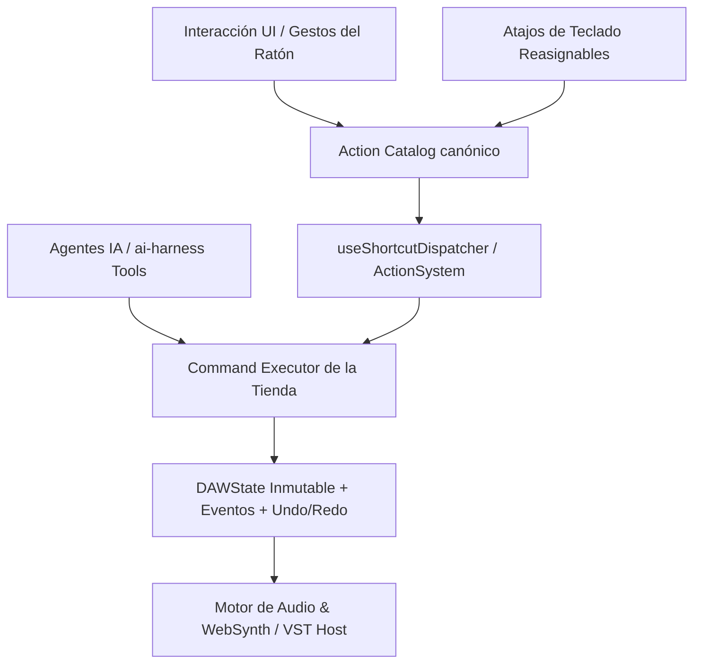

# Plan de Especificación y Arquitectura Técnica Definitiva: Clips, Piano Roll, Catálogo de Atajos e Integración con IA

> **Estado**: Alineado y aprobado tras la sesión de entrevista arquitectónica (`/grill-me`).
> **Objetivo**: Resolver de raíz todas las brechas de herramientas, interacción y atajos de teclado en el flujo de trabajo con Clips (MIDI/Audio) y el Piano Roll, garantizando configurabilidad total por el usuario y control de alta precisión para la IA.

---

## 1. Arquitectura de Acciones, Atajos y Gobernanza IA

Todas las operaciones se implementan bajo el principio de **triple acceso unificado**:
1. **Acceso Visual**: Botones, manijas e interactores contextuales en Canvas / UI.
2. **Acceso por Teclado Configurable**: Acciones registradas en el `ActionCatalog` canónico (`shared/src/actions/catalog.ts`), reasignables en la ventana de atajos (`Ctrl+Shift+,`) y buscables en la Paleta de Comandos (`Ctrl+Shift+P`).
3. **Acceso de Alta Precisión para la IA**: Comandos tipados y auditados en `tienda.executor` con herramientas correspondientes en `@jaswave/ai-harness` (precisión en samples, beats, Hz, ms y seeds deterministas).



---

## 2. Fase 1: Piano Roll (Edición MIDI Completa)

### 2.1. Mute de Notas Individuales
- **Modelo de Datos**: Utilizar `MidiNote.mute?: boolean`.
- **Comando**: `midi.notes.mute` (soporta toggle, mute forzado y unmute forzado para lista de `noteIds`).
- **Renderizado Visual**:
  - En `piano-roll-canvas-notes.tsx` y en el DOM: notas muteadas se dibujan con opacidad al **35%**, borde punteado (`strokeDasharray: '3 2'`) y sin brillo.
- **Comportamiento Auditivo**:
  - `playback-provider.tsx` ya filtra `!n.mute` durante la reproducción del timeline.
  - Al hacer clic o selección con el ratón sobre notas muteadas: **no emiten sonido de preview** (evita notas falsas al editar).
  - Doble clic o presionar `M`: reactiva la nota y reproduce su audition sound.
- **Acción Canónica**: `pianoRoll.muteNotes` (Atajo por defecto: `M`).

### 2.2. Herramienta Tijera / Corte de Notas (Slice Tool)
- **Modo Interactivo**:
  - Nueva herramienta en `PianoRollToolbar`: icono de tijeras (`Scissors`), atajo de herramienta `C`.
  - En modo `slice`:
    - El cursor cambia a crosshair con guía vertical de corte.
    - Clic simple en una nota: la corta en el punto exacto redondeado al Snap actual (`snapBeat`).
    - Clic y arrastre vertical: traza una línea de corte roja que divide simultáneamente todas las notas que intersecta (ideal para cortar acordes enteros o ráfagas).
- **Atajo en Playhead**:
  - Atajo `Shift+S` o `Ctrl+K`: divide las notas seleccionadas en la posición actual del playhead del Piano Roll.
- **Comando de Tienda**: `midi.notes.split` (divide nota en dos respetando ID único y velocidades).

### 2.3. Transformaciones Musicales (Barra de Herramientas y Menú Contextual)
En `PianoRollToolbar` se agrega el grupo **"Transformar"** (menú popover + botones rápidos) y menú contextual de notas:

1. **Legato (`pianoRoll.legato` — Atajo `Alt+L`)**:
   - Conecta con `makeLegato` en `shared/src/midi/note-ops.ts`.
   - Extiende la duración de cada nota seleccionada hasta el inicio de la siguiente nota del mismo tono (o de cualquier nota según opción).
2. **Staccato (`pianoRoll.staccato` — Atajo `Shift+S` / `Alt+S`)**:
   - Conecta con `makeStaccato`. Acorta la duración de las notas seleccionadas al 50% de su longitud.
3. **Humanize (`pianoRoll.humanize` — Atajo `Alt+H`)**:
   - Abre popover con sliders de:
     - *Timing Amount*: micro-desplazamiento en beats (0 a 0.05 beats / ~10ms).
     - *Velocity Amount*: variación aleatoria de velocity (±1 a ±15).
   - Generación determinista con PRNG (`mulberry32`) reproducible por la IA.
4. **Invertir Tonalidad (`pianoRoll.invert` — Atajo `Alt+I`)**:
   - Conecta con `invertPitches` de `note-ops.ts` (espejo tonal sobre el centroide armónico).
5. **Reverse Temporal (`pianoRoll.reverse` — Atajo `Alt+R`)**:
   - Conecta con `reverseInTime` (invierte el orden temporal de las notas seleccionadas).
6. **Time Stretch (`pianoRoll.stretchDouble` / `pianoRoll.stretchHalf` — `Alt+2` / `Alt+1`)**:
   - Escala tiempos y duraciones al 200% o 50% con un toque.

### 2.4. Guías de Escala (Scale Highlighting) y Snap Tonal
- **Selector en Toolbar**:
  - Selector de Tónica: `C`, `C#`, `D`, `D#`, `E`, `F`, `F#`, `G`, `G#`, `A`, `A#`, `B`.
  - Selector de Escala: Mayor, Menor, Dórica, Frigia, Lidia, Mixolidia, Pentatónica Mayor, Pentatónica Menor, Blues.
  - Checkbox / Toggle: **"Snap a Escala"** (`pianoRoll.toggleScaleSnap`).
- **Renderizado Visual**:
  - En el fondo del grid del Piano Roll, las filas de pitch correspondientes a notas dentro de la escala se pintan con un tono ligeramente iluminado (`rgba(255,255,255,0.03)` en modo oscuro), mientras que las filas ajenas a la escala se muestran más oscuras.
  - En el teclado virtual izquierdo, pequeños marcadores de punto identifican los grados de la escala activa.
- **Comportamiento con Snap Tonal Activado**:
  - Al dibujar notas con el lápiz o trasponer con las flechas `↑ / ↓`, las notas se ajustan automáticamente al grado más cercano de la escala activa usando `snapPitchToScale` de `shared/src/midi/scale.ts`.

### 2.5. Selección por Tono (Pitch Selection)
- **Gesto en Teclado Lateral**:
  - `Alt + Clic` en cualquier tecla virtual del piano lateral: selecciona automáticamente todas las notas del clip que coincidan con ese pitch (ej. seleccionar todos los C1 de un patrón de batería).
  - `Shift + Alt + Clic`: añade ese pitch a la selección actual.

---

## 3. Fase 2: Clips de Audio y Arrangement View

### 3.1. Handles de Fade In / Fade Out en Clips de Audio
- **Interacción Visual**:
  - En las esquinas superiores izquierda y derecha de cada clip de audio aparecen dos manijas triangulares de control al pasar el cursor (hover).
  - **Arrastre horizontal**: ajusta la duración del fade (`fadeIn.duracion` / `fadeOut.duracion`).
  - **Arrastre vertical**: altera la curvatura del fade (`curva: 'lineal' | 'exponencial' | 'logaritmica'`).
  - El fondo de la forma de onda del clip dibuja la curva de atenuación sombreada en tiempo real.
- **Atajo Anti-Clicks**:
  - Atajo `F` (`clip.autoFade`): aplica automáticamente un fundido rápido de 10ms en los extremos del clip para eliminar chasquidos o discontinuidades en los puntos de corte.
- **Comando de Tienda**: `clip.setFade` (actualiza `fadeIn` y `fadeOut` en el clip).

### 3.2. Mute de Clip (Audio y MIDI)
- **Modelo**: Añadir `silenciado?: boolean` a la interfaz base `Clip`.
- **Interacción y Atajo**:
  - Tecla `0` (Cero) o menú contextual "Silenciar Clip": alterna el estado de los clips seleccionados.
  - Clip silenciado: se renderiza con opacidad del 40%, franjas diagonales tenues y etiqueta `[MUTE]` en su encabezado.
  - El motor de audio y el reproductor de MIDI omiten los clips silenciados durante el playback.
- **Comando**: `clip.toggleMute`.

### 3.3. Desplazamiento Interno de Audio (Slip Editing)
- **Interacción**:
  - `Alt + Shift + Arrastrar` dentro del cuerpo de un clip de audio:
    - Mantiene fijos el inicio y el fin del clip en la línea de tiempo del proyecto.
    - Modifica `clipInicio` (el offset de lectura del archivo de audio) desplazando la forma de onda internamente.
- **Comando**: `clip.update` con `{ clipInicio: nuevoOffset }`.

### 3.4. Ganancia por Clip (Clip Gain)
- **Interacción**:
  - Manija central horizontal en el borde superior del clip de audio con tooltip numérico en decibelios (`dB`).
  - Permite nivelar rápidamente tomas de voz o instrumentos sin crear automatizaciones de pista.

### 3.5. Consolidación de Clips (`Ctrl+J`)
- **Comando**: `clip.consolidate` (Atajo `Ctrl+J`).
- **Comportamiento**:
  - Para clips MIDI: fusiona los clips seleccionados de la pista rellenando los silencios en un único clip continuo.
  - Para clips de audio: unifica los segmentos de audio en una nueva toma consolidada.

---

## 4. Matriz de Acciones en el Catálogo Canónico (`ActionCatalog`)

Se incorporan formalmente al catálogo de acciones (`shared/src/actions/catalog.ts`) para que el usuario pueda reasignar cualquier atajo en `Ctrl+Shift+,`:

| ID Canónico | Nombre en Español | Categoría | Contexto | Atajo por Defecto |
|---|---|---|---|---|
| `pianoRoll.toolSelect` | Herramienta Selección | PianoRoll | pianoRoll | `V` |
| `pianoRoll.toolPencil` | Herramienta Lápiz / Dibujar | PianoRoll | pianoRoll | `D` / `B` |
| `pianoRoll.toolEraser` | Herramienta Borrador | PianoRoll | pianoRoll | `E` / `X` |
| `pianoRoll.toolSlice` | Herramienta Tijeras / Cuchilla | PianoRoll | pianoRoll | `C` |
| `pianoRoll.muteNotes` | Silenciar / Activar notas | PianoRoll | pianoRoll | `M` |
| `pianoRoll.splitAtPlayhead` | Dividir notas en playhead | PianoRoll | pianoRoll | `Shift+S` |
| `pianoRoll.legato` | Forzar Legato | PianoRoll | pianoRoll | `Alt+L` |
| `pianoRoll.staccato` | Forzar Staccato | PianoRoll | pianoRoll | `Alt+S` |
| `pianoRoll.humanize` | Humanizar notas | PianoRoll | pianoRoll | `Alt+H` |
| `pianoRoll.reverse` | Invertir tiempo (Reverse) | PianoRoll | pianoRoll | `Alt+R` |
| `pianoRoll.invert` | Invertir tonos (Invert) | PianoRoll | pianoRoll | `Alt+I` |
| `pianoRoll.stretchDouble` | Doble de tempo (×2) | PianoRoll | pianoRoll | `Alt+2` |
| `pianoRoll.stretchHalf` | Mitad de tempo (÷2) | PianoRoll | pianoRoll | `Alt+1` |
| `pianoRoll.toggleScaleSnap` | Activar/desactivar Snap a Escala | PianoRoll | pianoRoll | `Alt+K` |
| `pianoRoll.dedupe` | Quitar notas duplicadas | PianoRoll | pianoRoll | `Ctrl+Shift+D` |
| `clip.toggleMute` | Silenciar / Activar Clip | Clip | arrangement | `0` |
| `clip.autoFade` | Fundido automático anti-clics | Clip | arrangement | `F` |
| `clip.consolidate` | Consolidar clips | Clip | arrangement | `Ctrl+J` |
| `clip.reverseAudio` | Invertir audio | Clip | arrangement | `Alt+R` |
| `clip.normalizeAudio` | Normalizar volumen del clip | Clip | arrangement | `Alt+N` |

---

## 5. Exposición de Herramientas de Alta Precisión para la IA

En `@jaswave/ai-harness` se registran herramientas de control con esquemas de parámetros exactos:

1. `midi_transform_notes`:
   - Parámetros: `trackId`, `clipId`, `operation: 'legato' | 'staccato' | 'humanize' | 'reverse' | 'invert' | 'timeStretch' | 'constrainScale'`, `noteIds?: string[]`, `options: { strength, seed, timingAmount, velocityAmount, scaleRoot, scaleType, factor }`.
2. `midi_mute_notes`:
   - Parámetros: `trackId`, `clipId`, `noteIds: string[]`, `mute: boolean`.
3. `midi_slice_notes`:
   - Parámetros: `trackId`, `clipId`, `cutBeat: number`, `noteIds?: string[]`.
4. `clip_set_fade`:
   - Parámetros: `trackId`, `clipId`, `type: 'in' | 'out'`, `durationSeconds: number`, `curve: 'lineal' | 'exponencial' | 'logaritmica'`.
5. `clip_set_mute`:
   - Parámetros: `trackId`, `clipId`, `silenciado: boolean`.
6. `clip_slip_content`:
   - Parámetros: `trackId`, `clipId`, `clipInicioSeconds: number`.

---

## 6. Plan de Verificación y Testing

### Automatizado
- Tests de comandos en `shared/src/commands/`:
  - `midi.notes.mute` con undo/redo determinista.
  - `midi.notes.split` con integridad de IDs y duraciones.
  - `clip.setFade` y `clip.toggleMute` con transiciones de estado válidas.
- Tests de harness en `ai-harness`:
  - Ejecución de las nuevas herramientas de IA con verificación de resultados numéricos exactos.
- Build y comprobación de tipos:
  ```bash
  npm run verify
  ```

### Manual
1. **Piano Roll**:
   - Probar herramienta Tijera (`C`) arrastrando verticalmente sobre un acorde: verificar corte simultáneo limpio.
   - Seleccionar notas y presionar `M`: verificar aspecto atenuado (35%) y silencio en reproducción.
   - Probar `Alt+L` (Legato) y `Alt+H` (Humanize con sliders): comprobar visual y auditivamente.
   - Activar "Snap a Escala" en D Menor y dibujar notas: verificar que ninguna caiga fuera de la escala.
   - `Alt+Clic` en la tecla F#3 del teclado lateral: verificar selección inmediata de todos los F#3.
2. **Arrangement & Clips**:
   - Presionar `0` en clips de audio y MIDI: comprobar que se atenúan y no reproducen sonido.
   - Arrastrar manijas de Fade In en la esquina superior izquierda del clip de audio y verificar curvatura.
   - `Alt+Shift+Arrastrar` sobre un clip de audio para confirmar el Slip Editing.
   - Abrir diálogo de Atajos (`Ctrl+Shift+,`) y reasignar cualquier nuevo comando para comprobar persistencia.
