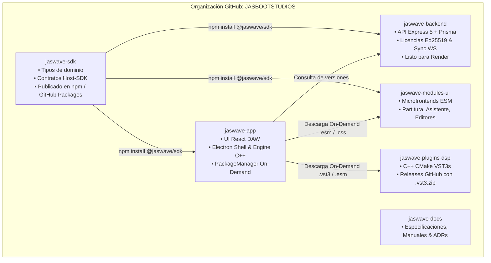
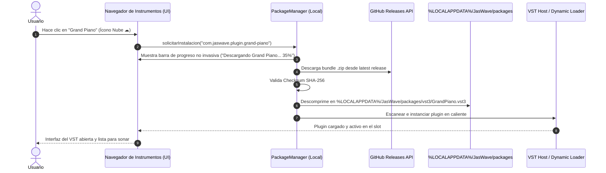

# Plan Maestro: Desacoplamiento Multi-Repo y Ecosistema JasWave Modular On-Demand

## 1. Goal Description

Transformar la arquitectura de JasWave de un monorepo acoplado (`jaswave-monorepo`) hacia un **ecosistema de repositorios independientes (Polyrepo)** 100% autónomos en despliegue, con un instalador cliente ultraligero (**Zero-Tool / Lean Core < 40 MB**), aprovisionamiento de herramientas en caliente bajo demanda (JIT), sistema de auto-actualización in-app para cada componente y control de licencias con período de prueba (Trial) de 14 días sellado localmente sin login obligatorio.

---

## 2. Decisiones Arquitectónicas Consolidadas (Vía /grill-me)

| Aspecto | Decisión Acordada | Justificación Técnica |
|---|---|---|
| **Almacenamiento y CDN de Descargas** | **GitHub Releases** de cada repositorio oficial | CDN global distribuido gratuito, versionado semántico inmutable por tags y alta velocidad sin costes de ancho de banda en servidores propios. |
| **Granularidad de Repositorios** | Repositorios agrupados por naturaleza funcional | Evita la dispersión inmanejable de decenas de micro-repositorios manteniendo límites de compilación 100% aislados. |
| **Separación Física Local** | Carpetas hermanas en `c:\src\` | Mantiene `c:\src\jaswave-ia` intacto como respaldo seguro mientras se configuran y verifican los nuevos repositorios. |
| **Autonomía de Despliegue** | Cero dependencias relativas `../` | El backend despliega sin errores en **Render**; la app web despliega en **Vercel/Cloudflare Pages** y el instalador desktop en **GitHub Actions**. |
| **Descubrimiento de Herramientas** | Catálogo integrado en el navegador con icono de nube ☁ | El usuario ve todas las herramientas disponibles; al arrastrar o pulsar se descargan y montan en caliente sin reiniciar. |
| **Auto-Actualización In-App** | Alerta no invasiva de actualización por componente | El DAW, plugins y módulos detectan nuevas versiones en releases y se actualizan con un clic sin salir de la app ("Actualizar ahora" o "Recordar después"). |
| **Trial 14 Días y Licencias** | Sellado criptográfico local (Machine ID) | Todos los VSTs abren con 14 días de prueba gratis sin login. Al vencer, muestra un mensaje claro con los pasos de adquisición. |
| **Panel Admin de Licencias** | Sección de administración en el DAW/Backend | Permite al admin gestionar concesiones y qué usuarios tienen derecho a descargar versiones completas. |

---

## 3. Topología de Repositorios Independientes



### 3.1. Detalle de Repositorios Locales en `c:\src\`

1. **`c:\src\jaswave-sdk`**
   - Paquete npm autónomo `@jaswave/sdk` que unifica los tipos de dominio (`shared/src/types`) y los contratos del host de módulos (`DefinicionModulo`, `ContextoHostModulo`, etc.).
   - Compilación limpia a `.d.ts` y `.js` (ESM y CJS).
   - Sin dependencias de Electron ni de frameworks UI.

2. **`c:\src\jaswave-backend`**
   - Totalmente desacoplado de las carpetas del frontend o plugins.
   - `package.json` autocontenido con sus dependencias (`prisma`, `express`, `jsonwebtoken`, etc.).
   - Variables de entorno (`.env.example`) listas para despliegue en **Render** con base de datos PostgreSQL/Supabase.
   - Rutas de licencias, roles, auditoría y el endpoint de catálogo `/catalogo/modulos`.

3. **`c:\src\jaswave-app`**
   - El DAW en sí mismo. Contiene la UI React, el host de plugins en C++ (`native/plugin-host`), el motor de transporte y el nuevo subsistema `PackageManager`.
   - Compilaciones soportadas:
     - **Web**: `npm run build:web` (despliegue estático sin referencias al proceso desktop).
     - **Desktop**: `npm run build && electron-builder` (genera instalador ligero NSIS < 40 MB).
   - No incluye ningún VST3 pesado en sus recursos empaquetados.

4. **`c:\src\jaswave-plugins-dsp`**
   - Suite de instrumentos y procesadores C++ VST3:
     - `grand-piano`, `electric-bass`, `electric-guitar`, `strings-section`, `worship-drums`, `param-eq`, `bus-compressor`, `truepeak-limiter`, `smart-deesser`, etc.
   - Configuración CMake independiente con GitHub Actions que compila en `win-x64` y genera un release por tag con artefactos comprimidos (ej. `jaswave-plugin-grand-piano-v1.0.0.zip`).

5. **`c:\src\jaswave-modules-ui`**
   - Módulos web de UI y extensiones:
     - `com.jaswave.modulo.partitura`, `com.jaswave.modulo.asistente-ia`, `com.jaswave.modulo.documentos`, `com.jaswave.modulo.editores-vst`, `com.jaswave.modulo.midi-md`.
   - Pipeline Vite library mode que genera bundles ESM + CSS versionados e independientes.

6. **`c:\src\jaswave-docs`**
   - Todo el acervo documental técnico, especificaciones de arquitectura, manuales de usuario y actas de decisiones (ADRs).
   - Generación opcional de sitio estático con VitePress/Docusaurus.

---

## 4. Ciclo de Vida: Descarga On-Demand, Caché y Auto-Actualización

### 4.1. Flujo de Descarga en Caliente (Just-In-Time)



### 4.2. Sistema de Auto-Actualización In-App

1. **Comprobación Periódica Silenciosa:**
   - Al iniciar el DAW (y opcionalmente cada 24 h en segundo plano si hay conexión), el DAW consulta el catálogo o la API de GitHub Releases para:
     - La versión del DAW (`jaswave-app`).
     - Las versiones de cada VST o módulo instalado localmente.
2. **Notificación Amigable:**
   - Si se detecta una nueva versión de un componente (ej. `Grand Piano v1.2.0` teniendo instalada la `v1.1.0`), la interfaz muestra una campana o badge discreto:
     > *"Actualización disponible para Grand Piano (v1.2.0). ¿Deseas actualizar ahora o recordar más tarde?"*
3. **Actualización Atómica con 1 Clic:**
   - Si el usuario pulsa **Actualizar Ahora**, se descarga en segundo plano, se reemplaza la versión en caché local y se recarga el componente sin que el usuario deba buscar instaladores en la web.
   - Si el usuario pulsa **Más tarde**, el aviso se silencia hasta la próxima sesión.

---

## 5. Sistema de Licenciamiento y Período de Prueba (Trial 14 Días)

### 5.1. Mecanismo de Trial Offline Sellado

Para garantizar que un usuario pueda probar cualquier VST sin fricción ni registro durante dos semanas:

1. **Primer Uso:**
   - La primera vez que el usuario abre un VST JasWave (ej. `ParamEQ.vst3`), el VST consulta la presencia de una licencia en `%LOCALAPPDATA%/JasWave/licenses/`.
   - Si no existe licencia comercial, genera un archivo `trial-<pluginId>.lic`:
     ```json
     {
       "pluginId": "com.jaswave.plugin.param-eq",
       "machineId": "SHA256(CPU_ID + DISK_SERIAL + OS_UUID)",
       "trialStartedAt": 1793030400,
       "expiresAt": 1794240000,
       "integritySeal": "HMAC_SHA256(machineId + trialStartedAt + SECRET_SALT)"
     }
     ```
2. **Validación en Cada Apertura:**
   - El VST calcula el `machineId` actual y valida la firma del sello local.
   - Comprueba que la hora del sistema no haya sido manipulada hacia atrás (revisando timestamps de archivos del sistema / monotonic clock).
   - Durante los 14 días: El VST opera al 100% de su capacidad sin restricciones de audio ni ventanas de login.
   - Encabezado discreto en el VST: `"Versión de Prueba — Quedan X días"`.

3. **Finalización del Período de Prueba:**
   - Al cumplirse los 14 días, el procesamiento de audio se silencia suavemente y el VST muestra un diálogo claro:
     > **"Tu período de prueba de 14 días para [Nombre Plugin] ha finalizado."**  
     > *Para continuar usando este plugin:*  
     > 1. Adquiere tu licencia en `jaswave.com/store` o mediante tu cuenta JasWave.  
     > 2. Haz clic en **Activar Licencia** para iniciar sesión o pegar tu clave.  
     > [ Botón: Activar Licencia ] [ Botón: Probar otros plugins ]

4. **Panel Admin en el DAW:**
   - Pestaña especial en la configuración del DAW (accesible para usuarios con rol Admin):
     - Lista de plugins adquiridos por el usuario o la organización.
     - Botón para forzar sincronización de licencias con el backend.
     - Indicador del estado de cada plugin (Trial activo / Licencia definitiva / Expirado).

---

## 6. Plan de Implementación por Fases

### Fase 1: Creación del SDK Autónomo (`c:\src\jaswave-sdk`)
- Extraer `shared/src/types` y `jas-wave/src/modulos/sdk` a un proyecto npm independiente.
- Configurar build con `tsup` o `tsc` para generar distribución ESM y CJS con tipados `.d.ts`.
- Verificar que compila limpiamente sin advertencias.

### Fase 2: Aislamiento del Backend (`c:\src\jaswave-backend`)
- Copiar `backend/` a `c:\src\jaswave-backend`.
- Ajustar `package.json` para que consuma `@jaswave/sdk` y eliminar cualquier referencia relativa a directorios superiores.
- Añadir el endpoint `/catalogo/modulos` y `/catalogo/modulos/:id/release`.
- Probar que `npm run build` y `npm test` funcionan de manera 100% aislada.
- Generar Dockerfile o `render.yaml` para despliegue inmediato en Render.

### Fase 3: Desacoplamiento de Plugins y Módulos
- **C++ VST3s (`c:\src\jaswave-plugins-dsp`)**:
  - Migrar `plugins/com.jaswave.plugin.*` y `native/` relevante con su `CMakeLists.txt` raíz.
  - Script de empaquetado `.zip` para GitHub Releases con checksum SHA-256.
  - Implementar en `shared-license` el motor de Trial 14 días offline con Machine ID.
- **Módulos UI (`c:\src\jaswave-modules-ui`)**:
  - Migrar `plugins/com.jaswave.modulo.*` a proyecto Vite library.
  - Compilación de bundles `.esm.js` + `.css`.

### Fase 4: Refactorización del DAW Client (`c:\src\jaswave-app`)
- Migrar `jas-wave/` a `c:\src\jaswave-app`.
- Eliminar dependencias locales relativas (`file:../shared`, `file:../ai-harness`) sustituyéndolas por dependencias limpias.
- Implementar el `PackageManager` en el proceso main de Electron y en el renderer:
  - Descarga HTTP con stream y barra de progreso.
  - Descompresión en `%LOCALAPPDATA%/JasWave/packages/`.
  - Verificación de hash SHA-256.
  - Notificación de nuevas versiones y actualización in-app en 1 clic.
- Configurar `electron-builder.cjs` para empaquetado ultraligero (< 40 MB).

### Fase 5: Documentación (`c:\src\jaswave-docs`)
- Extraer `docs/` a `c:\src\jaswave-docs`.
- Inicializar repositorio Git y dejar la documentación centralizada y ordenada.

---

## 7. Verification Plan

### Automated Tests
1. **Compilación Aislada de Cada Repositorio:**
   - En `jaswave-backend`: `npm run typecheck && npm test && npm run build` (debe pasar con 0 errores sin ninguna otra carpeta presente).
   - En `jaswave-sdk`: `npm run build && npm test`.
   - En `jaswave-app`: `npm run typecheck && npm test && npm run build:web`.
2. **Test del Instalador Base:**
   - Ejecutar `npm run pack:win` en `jaswave-app` y verificar que el tamaño del instalador esté por debajo de 40 MB.
3. **Tests Unitarios del Gestor de Licencias:**
   - Probar generación de `trial.lic`, cálculo de días restantes y bloqueo automático tras el día 14.

### Manual Verification
1. **Despliegue de Backend:**
   - Desplegar `jaswave-backend` en Render y verificar `GET /health` y `GET /catalogo/modulos`.
2. **Instalación y Primer Arranque en Frío:**
   - Instalar `jaswave-app` en un sistema limpio.
   - Constatar que la carpeta de plugins esté vacía.
3. **Flujo On-Demand:**
   - Arrastrar un plugin (ej. `ParamEQ`) desde la lista con ícono de nube.
   - Verificar la barra de descarga, verificación e inserción en el canal sin interrupción.
4. **Verificación de Trial:**
   - Comprobar que el plugin abre de inmediato sin pedir credenciales y con la etiqueta `"14 días de prueba"`.
