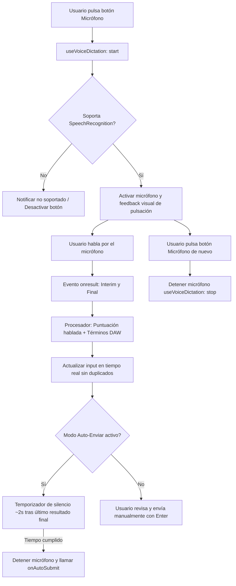

# Plan de Implementación: Dictado por Voz Estilo Teclado Móvil (Web Speech API) en JasWave

Este documento describe la arquitectura y los pasos técnicos para incorporar la funcionalidad de dictado por voz en tiempo real (speech-to-text) en **JasWave DAW**, emulando la experiencia de dictado de teclados móviles (Android Gboard), sin requerir modelos de audio locales pesados (como Whisper o Vosk), y aplicable a múltiples áreas del DAW (Asistente IA, paleta de comandos y notas de pista).

---

## 1. Descripción del Objetivo

El usuario desea dictar con el micrófono y ver cómo el texto se escribe en tiempo real en la aplicación tal como ocurre en el teclado de Google en Android:
- **Sin modelos pesados locales**: Utilizar la API nativa del navegador / Chromium (`webkitSpeechRecognition` / `SpeechRecognition`), con latencia ultrabaja y cero consumo de GPU/VRAM.
- **Visualización en tiempo real**: Transcripción provisional fluida (*interim results*) que se confirma (*final results*) sin duplicar palabras en el cuadro de texto.
- **Modo Dual Conmutable**:
  - *Modo Solo Transcribir* (por defecto en notas y búsqueda): escribe el texto y permite editar/revisar antes de enviar.
  - *Modo Auto-Enviar* (en Asistente IA): detecta silencio (~2 segundos tras dejar de hablar) y envía automáticamente el mensaje o comando al Asistente Jas.
- **Atajo de Teclado Rápido (`Alt+V`)**:
  - Permite activar o desactivar el micrófono al instante sin necesidad de levantar las manos del teclado o mover el ratón.
- **Feedback Auditivo Sutil (Chime Estilo Android)**:
  - Generado puramente en código mediante **Web Audio API** (oscilador senoidal con envolvente suave `gainNode`), sin requerir archivos de audio externos (`.wav`/`.mp3`).
  - Emite un tono ascendente suave al iniciar ("bloop") y un tono descendente al detenerse.
- **Puntuación y Jerga Musical Inteligente**: Convierte comandos de voz como *"punto"*, *"coma"*, *"salto de línea"* en signos ortográficos y preserva términos técnicos del DAW (*BPM*, *MIDI*, *VST*, *Sidechain*, *Reverb*, *Master*).
- **Disponibilidad Global**:
  1. Panel del Asistente IA (`coproducer-panel.tsx`).
  2. Paleta de comandos y buscador global (`command-palette.tsx`).
  3. Inspector de notas y comentarios de pista (`track-detail-panel.tsx`).

---

## 2. Decisiones de Diseño y Puntos de Revisión

> [!NOTE]
> **Compatibilidad en Electron y Navegador**:
> En Chrome y Edge (`http://localhost:5173`), `SpeechRecognition` funciona sin configuración extra.
> En entornos Electron empaquetados donde Chromium no tiene API Keys de Google, si la Web Speech API no responde o da error de red, el hook degrada elegantemente mostrando un aviso amigable y permitiendo escribir manualmente sin romper la interfaz.

> [!TIP]
> **Prevención de Duplicación de Texto**:
> El error más común al usar `interimResults: true` en React es concatenar directamente cada evento al estado `inputMessage`. La solución consiste en guardar un `anchorText` (lo que estaba escrito antes de pulsar el micro) y actualizar `inputMessage = anchorText + ' ' + (finalAcumulado + ' ' + interimActual)`.

---

## 3. Hoja de Ruta de Implementación Paso a Paso

La implementación se ejecutará en 5 pasos secuenciales y cohesivos:

1. **Paso 1: Núcleo de Formateo y Puntuación (`@jaswave/shared`)**:
   - Crear `shared/src/voice/voice-text-formatter.ts`.
   - Implementar formateador inteligente (puntuación hablada + normalización técnica de audio).
   - Escribir y ejecutar test unitario `shared/src/test/voice-text-formatter.test.ts`.

2. **Paso 2: Feedback Sonoro con Web Audio API (`jas-wave`)**:
   - Crear `jas-wave/src/lib/audio-chime.ts` con oscilador de frecuencia y decaimiento suave para inicio (`600Hz -> 900Hz`) y parada (`800Hz -> 500Hz`).

3. **Paso 3: Hook de Dictado y Componente Visual Reutilizable**:
   - Crear `jas-wave/hooks/use-voice-dictation.ts` con manejo de estados, buffer anti-duplicación, temporizador de silencio para auto-enviar y escucha de atajo `Alt+V`.
   - Crear `jas-wave/components/ui/voice-dictation-button.tsx` con animación de pulsación/onda y selector rápido de modo (Transcripción / Auto-enviar).

4. **Paso 4: Integración en los 3 Puntos del DAW**:
   - Actualizar el Asistente IA (`coproducer-panel.tsx`) conectando el auto-envío directo.
   - Añadir el botón en la paleta de comandos (`command-palette.tsx`).
   - Añadir el botón en el cuadro de notas de pista (`track-detail-panel.tsx`).

5. **Paso 5: Verificación y Validación**:
   - Ejecutar `npm run verify` (lint + typecheck + tests).
   - Probar en vivo en el navegador / app activa.

---

## 3. Diagrama de Flujo del Dictado



---

## 4. Cambios Propuestos

### Componente 1: Núcleo y Formateo de Texto Hablado (`@jaswave/shared`)

#### [NEW] `shared/src/voice/voice-text-formatter.ts`
Funciones puras de formateo para transformar la transcripción cruda de voz:
- Sustitución de puntuación hablada en español:
  - `" punto y coma"` / `" punto y coma "` → `"; "`
  - `" coma "` → `", "`
  - `" dos puntos "` → `": "`
  - `" signo de interrogación "` / `" signo de pregunta "` → `"?"`
  - `" signo de exclamación "` / `" signo de admiración "` → `"!"`
  - `" punto seguido "` / `" punto y seguido "` → `". "`
  - `" nueva línea "` / `" salto de línea "` → `"\n"`
- Preservación y capitalización de términos de audio y producción musical:
  - `midi` → `MIDI`, `vst` → `VST`, `bpm` → `BPM`, `db` → `dB`, `eq` → `EQ`, `pan` → `Pan`.
- Limpieza de espaciados dobles y capitalización tras puntos o saltos de línea.

#### [NEW] `shared/src/test/voice-text-formatter.test.ts`
Tests unitarios exhaustivos con Vitest para validar las sustituciones de puntuación y preservación de términos técnicos.

---

### Componente 2: Hook y Componente Reutilizable (`jas-wave`)

#### [NEW] `jas-wave/hooks/use-voice-dictation.ts`
Hook de React para gestionar el ciclo de vida del reconocimiento de voz:
```typescript
export interface UseVoiceDictationOptions {
  lang?: string
  continuous?: boolean
  autoSendDelayMs?: number | null // null = deshabilitado; número = ms de silencio para auto-enviar
  onTranscriptChange: (text: string, isFinal: boolean) => void
  onAutoSubmit?: (finalText: string) => void
  formatPunctuation?: boolean
}
```
Responsabilidades:
1. Instanciar `webkitSpeechRecognition` o `SpeechRecognition`.
2. Mantener buffers separados para texto base anterior, texto final confirmado y texto provisional intermedio.
3. Timer de debounce para auto-envío si está configurado `autoSendDelayMs`.
4. Manejo de errores (`not-allowed`, `no-speech`, `network`) con estados legibles para la UI.

#### [NEW] `jas-wave/components/ui/voice-dictation-button.tsx`
Componente visual de botón de micrófono:
- Animación de onda sonora / pulso con gradiente activo cuando está escuchando.
- Tooltip dinámico con atajo o estado ("Escuchando...", "Pausado").
- Menú contextual (o click secundario / botón desplegable) para alternar entre:
  - 🟢 *Solo transcribir*
  - ⚡ *Dictar y enviar al pausar (2s)*
- Estilos consistentes con el diseño de JasWave (Tailwind, `lucide-react`, paleta ámbar/rose).

---

### Componente 3: Módulo Asistente IA (`plugins/com.jaswave.modulo.asistente-ia`)

#### [MODIFY] `plugins/com.jaswave.modulo.asistente-ia/src/ui/speech-to-text-button.tsx`
- Reemplazar la lógica anterior por el nuevo hook `useVoiceDictation` y el formateador de voz inteligente.
- Agregar soporte para el modo conmutable de auto-envío (`autoSubmitOnSilence`).

#### [MODIFY] `plugins/com.jaswave.modulo.asistente-ia/src/ui/coproducer-panel.tsx`
- Conectar el `onAutoSubmit` del botón para disparar `handleSendMessage()` automáticamente cuando el usuario termine de dictar en modo auto-enviar.
- Asegurar que el foco vuelva al `inputRef` tras iniciar o detener el dictado.

---

### Componente 4: Integración en Búsqueda y Notas del DAW

#### [MODIFY] `jas-wave/components/command-palette.tsx`
- Integrar `<VoiceDictationButton />` en el extremo derecho del input de la paleta de comandos.
- Al hablar (ej. *"crear pista de audio"*, *"reproducir"*), transcribe directamente en el campo de búsqueda de comandos.

#### [MODIFY] `jas-wave/components/track-detail-panel.tsx`
- Añadir `<VoiceDictationButton />` junto a la etiqueta *"Notas / comentario"* de la pista seleccionada.
- Permite a los productores dictar notas de sesión y observaciones de mezcla rápidamente con las manos ocupadas en instrumentos o controladores MIDI.

---

## 5. Plan de Verificación

### Pruebas Automatizadas
1. **Tests unitarios del formateador de voz**:
   ```bash
   cd c:\src\jaswave-ia\shared
   npm test src/test/voice-text-formatter.test.ts
   ```
2. **Typecheck y Linter en todos los paquetes**:
   ```bash
   cd c:\src\jaswave-ia
   npm run verify
   ```

### Pruebas Manuales
1. **Asistente IA (Modo Transcripción)**:
   - Abrir el panel de Coproducer IA (`Ctrl+Shift+I` o icono de Asistente Jas).
   - Presionar el botón del micrófono y dictar: *"por favor agrega una pista de piano midi coma con tempo a 120 bpm punto"*
   - Verificar que el texto aparece sin duplicados en el cuadro de texto como *"por favor agrega una pista de piano MIDI, con tempo a 120 BPM."*.
2. **Asistente IA (Modo Auto-Enviar)**:
   - Alternar a modo auto-enviar en el botón de micrófono.
   - Decir una orden corta y guardar silencio por 2 segundos.
   - Verificar que el micrófono se apaga y el mensaje se envía automáticamente a la IA.
3. **Paleta de Comandos**:
   - Abrir la paleta con `Ctrl+K`.
   - Dictar el nombre de un comando y verificar que filtra la lista de comandos en tiempo real.
4. **Notas de Pista**:
   - Seleccionar una pista y abrir el inspector (`TrackDetailPanel`).
   - Dictar una nota en el cuadro de comentarios de la pista y verificar que se guarda en el estado del DAW.
