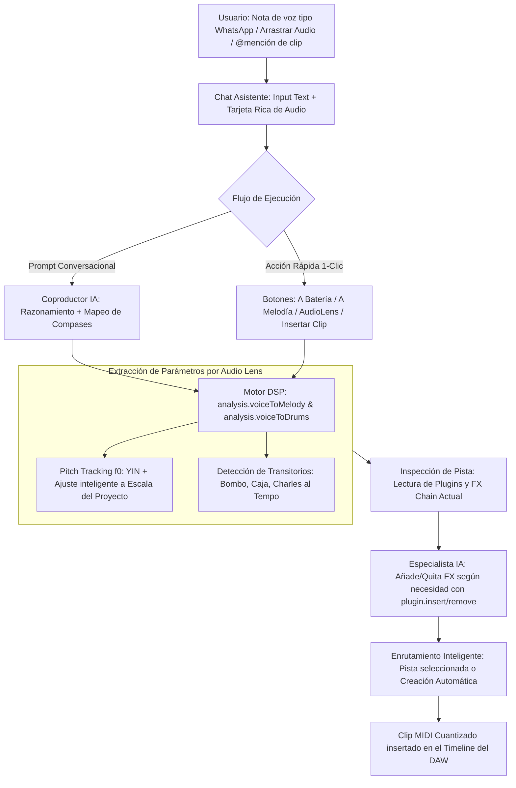

# Plan Maestro Definitivo JasWave DAW: Voice-to-MIDI, Suite de 6 Plugins VST3/WASM Independientes, Ecosistema de Agentes y Control de FX Chain

> **Consensuado, Profundizado y Blindado mediante la sesión `/grill-me`**.

---

## 1. Decisiones Arquitectónicas Consolidadas

### 1.1. Grabación de Notas de Voz en el Chat (Estilo WhatsApp) y Voice-to-MIDI por DSP
La IA opera como un **modelo de razonamiento de producción asistido por herramientas analíticas DSP deterministas** (no como un generador de audio opaco):

#### Especificación Detallada de la Interacción:
1. **Entrada de Voz Estilo WhatsApp en la Barra de Chat**:
   - Botón de micrófono reactivo en la barra del input del chat.
   - Grabación con cronómetro en segundos, visualizador de forma de onda en tiempo real y cancelación o envío directo.
   - Posibilidad de enviar la nota de voz sola o acompañada de un **input de texto libre** (ej. *"hazme un solo de guitarra eléctrica con esta melodía e insértalo en el compás 16 al 24"*).
   - Soporte para **arrastrar y soltar (drag & drop)** cualquier archivo de audio dentro del área de chat.
   - Soporte para autocompletar menciones de clips existentes escribiendo `@clip:NombreClip`.

2. **Flujo Dual Amplio (Conversacional + Acciones Rápidas)**:
   - **Tarjeta interactiva de audio**: Muestra reproductor Play/Pausa, visualización waveform, duración y opciones rápidas:
     - **`Convertir a Melodía`**: Permite elegir instrumento destino (Guitarra, Piano, Bajo, Sintetizador, Cuerdas), cuantización (sin cuantizar, 1/16, 1/8, 1/4) y compás de inserción.
     - **`Convertir a Batería`**: Extrae bombos, cajas y charles alineados al tempo del proyecto mediante `analysis.voiceToDrums`.
     - **`Analizar AudioLens`**: Extrae tonalidad, progresión de acordes, tempo y descripción musical detallada.
     - **`Insertar como Clip de Audio`**: Inserta la muestra original como clip de audio en la pista correspondiente.
   - **Flujo Conversacional por IA**: Si el usuario simplemente redacta su instrucción junto a la nota de voz, el Coproductor IA o el especialista mencionado (`@guitarrista`, `@baterista`, etc.) invoca la herramienta DSP adecuada, analiza la pista y ejecuta la creación sin fricción.

3. **Algoritmo DSP de Pitch Tracking ($f_0$) con Ajuste a Escala (`analysis.voiceToMelody`)**:
   - Implementado en TypeScript puro en `@jaswave/shared/src/audio/pitch-tracking.ts` (0 dependencias externas, 100% compatible con Electron y Web/Render, testea en Vitest a 60 fps).
   - Detección precisa de tono fundamental ($f_0$) mediante algoritmo YIN / autocorrelación normalizada.
   - **Ajuste inteligente con escala**: Centra la frecuencia al semitono afinado más cercano (12-TET) y, si el proyecto tiene tonalidad definida (ej. Re Menor), pondera la escala para corregir las notas desafinadas del canto o tarareo sin perder la intención melódica.
   - Fusión de notas consecutivas y eliminación de ruido no fonético/respiraciones.

4. **Enrutamiento Inteligente en el Timeline**:
   - Si el usuario tiene una pista de instrumento seleccionada en el DAW, el clip MIDI generado se inserta en esa pista.
   - Si no hay pista seleccionada o la seleccionada es de audio o master, se crea automáticamente una nueva pista de instrumento con el nombre y color representativo del instrumento solicitado.

---

### 1.2. Gobernabilidad de Plugins y Gestión de FX Chain por Especialistas IA
El usuario definió que los especialistas de la IA deben tener **visibilidad y control total sobre los plugins y efectos**:
- **Inspección de Cadena**: Los especialistas leen los plugins activos en la pista (`plugins=[...]`).
- **Mutación Dinámica**: Capacidad de insertar los efectos necesarios (`plugin.insert`), retirar los innecesarios (`plugin.remove`), conmutar bypass (`plugin.bypass`) y calibrar parámetros canónicos (`plugin.setParameter`).
- **Criterio de Especialista**:
  - `@guitarrista`: Verifica la presencia de simulador de amplificador, saturación o delay; inserta o ajusta la cadena si falta.
  - `@baterista`: Ajusta compresión y ecualización de pegada; retira reverberaciones excesivas en bajas frecuencias.
  - `@bajista`: Controla corte de agudos y compresión de graves.
  - `@director` / `@mezcla`: Valida el headroom y balance general.

---

### 1.3. Suite de 6 Plugins de Instrumentos Independientes (VST3 en Desktop + WASM en Web)
Cada instrumento es su propio paquete y plugin individual e independiente (no compartido), con estética cyber/futurista JasWave, **100% compatible con cualquier DAW VST3 (REAPER, Cubase)** y con réplica WebAssembly:

| Plugin Independiente | Tipo de Instrumento | Arquitectura de Sonido | Parámetros Expuestos para la IA | Compatibilidad |
|---|---|---|---|---|
| **`JasWave Grand Piano`** | Piano de cola acústico de concierto | Motor híbrido: modelado de resonancia de cuerdas y tabla armónica + muestras esenciales | `attack`, `decay`, `release`, `velocity_curve`, `brightness`, `reverb_send` | VST3 64-bit + WASM / AudioWorklet |
| **`JasWave Worship Drums`** | Batería acústica completa (kick, snare, toms, hi-hat, ride, crash) | Síntesis modal física de parches + transitorios muestreados con afinación por cuerpo | `kick_tune`, `snare_snap`, `toms_damp`, `overhead_air`, `room_blend` | VST3 64-bit + WASM / AudioWorklet |
| **`JasWave Electric Bass`** | Bajo eléctrico Precision / Jazz | Modelado físico de cuerda pulsada (Karplus-Strong extendido) con simulador de pastilla y drive | `tone`, `finger_attack`, `drive`, `low_boost`, `compressor_mix` | VST3 64-bit + WASM / AudioWorklet |
| **`JasWave Electric Guitar`** | Guitarra eléctrica (leads, solos, acordes) | Modelado de cuerda vibrante con módulo de distorsión, emulación de pantalla (cab sim) y delay | `amp_gain`, `cab_sim`, `tone`, `delay_feedback`, `chorus_mix` | VST3 64-bit + WASM / AudioWorklet |
| **`JasWave Shimmer Pad`** | Sintetizador ambiental de texturas y pads | Síntesis sustractiva/wavetable dual con motor de reverberación shimmer y octava superior | `cutoff`, `resonance`, `shimmer_octave`, `shimmer_decay`, `lfo_rate` | VST3 64-bit + WASM / AudioWorklet |
| **`JasWave Strings Section`** | Ensamble orquestal de cuerdas legato | Modelado de cuerda frotada con control continuo de expresión, vibrato y tamaño de sala | `expression`, `vibrato_depth`, `attack_time`, `release_time`, `hall_size` | VST3 64-bit + WASM / AudioWorklet |

---

### 1.4. Ecosistema de Agentes, Base de Conocimientos y Modo Grill-Me
- Comandos en español e inglés: `/aprender` (`/learn`), `/meta` (`/goal`), `/plan`, `/entrevista` (`/grill-me`), `/programar` (`/schedule`).
- Base de Conocimientos Markdown (`.md`) híbrida con recuperación bajo demanda y control RBAC (`Owner`, `Editor`, `Viewer`).
- Modo de aclaración interactivo con tarjetas de selección en el chat.

---

### 1.5. Estado Sincronizado, Versionado y Eliminación de VST2
- **Offline-First**: Cola local persistente con reconciliación vectorial.
- **Resolución Híbrida**: 3-way merge en MIDI + *Take Lanes* en audio.
- **Eliminación Total de VST2**: Retiro de `vst2_slot.*` en `native/plugin-host`; enfoque exclusivo en **VST3 64-bit**.
- **Waveforms de 0 ms**: Cache embebida en proyecto `.jaswave` y archivos `.peak`.

---

## 2. Hoja de Ruta de Ejecución Secuenciada

1. **Fase 3 (Foco Inmediato Prioritario Consensuado en Grill-Me)**:
   - [ ] Implementar algoritmo DSP de Pitch Tracking $f_0$ con ajuste a escala en `@jaswave/shared/src/audio/pitch-tracking.ts`.
   - [ ] Crear y registrar el comando `analysis.voiceToMelody` y la herramienta analítica `analysis.extractMidi`.
   - [ ] Integrar botón de notas de voz tipo WhatsApp en `audio-sample-recorder.tsx` y `coproducer-panel.tsx`.
   - [ ] Habilitar drag & drop de audio sobre el chat y autocompletado `@clip:`.
   - [ ] Conectar la acción de inspección y modificación de FX chain por los especialistas IA.
   - [ ] Test unitarios con Vitest y verificación funcional en caliente.

2. **Fase 4 (Suite de 6 Plugins VST3/WASM Independientes)**:
   - [ ] Estructurar los 6 paquetes independientes bajo `plugins/` con sus manifiestos V5 y parámetros IA.
   - [ ] Implementar los motores sonoros híbridos (DSP C++ para VST3 y AudioWorklet para Web).
   - [ ] UI futurista JasWave compartida entre editor nativo y réplica web.

3. **Fase 1 y 2 (Limpieza de Motor C++ y Waveforms 0 ms)**:
   - [ ] Retirar código VST2 de `native/plugin-host` (`vst2_slot.*`) y depurar escáner VST3.
   - [ ] Implementar waveforms cacheadas en `.peak` y buffer elástico de Named Pipe.

4. **Fase 5 y 6 (Comandos, Base de Conocimientos y Sincronización Multiusuario)**:
   - [ ] Comandos `/aprender`, `/meta`, `/plan`, etc., y servicio RBAC de conocimientos `.md`.
   - [ ] Sincronización WebSocket offline-first y presencia estilo Figma.

5. **Fase 7 (Verificación Integral y Lints)**:
   - [ ] `npm run verify` completo en verde y certificación del sistema.
