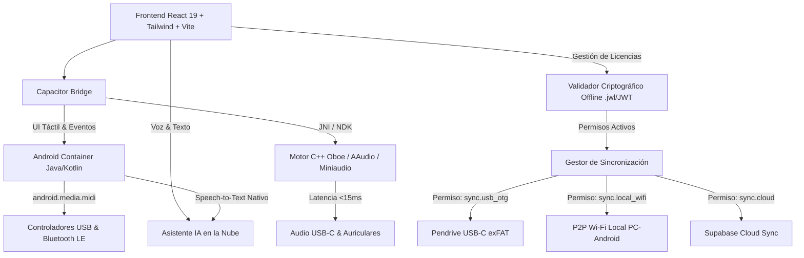

# Plan de Implementación: JasWave DAW — Versión Android Nativa

## Objetivo y Contexto

Desarrollar la versión móvil y tablet de **JasWave DAW** para el ecosistema **Android (Android 8.1+ / API 27+, optimizado para Android 10+ a 15)**, empaquetada como una aplicación nativa mediante **Capacitor** con un motor de audio nativo en C++ basado en **Google Oboe (AAudio)** para lograr latencia profesional ultra-baja en grabación y monitoreo.

La aplicación compartirá el 90%+ del código de dominio, estado y componentes con la versión de escritorio, ofreciendo una experiencia adaptativa (Tablet-First), sincronización multi-vía (USB-OTG, Wi-Fi Local y Nube) gobernada por un sistema de licencias y roles criptográficos, y compatibilidad total con proyectos de PC mediante congelado de pistas (Track Freezing).

---

## Decisiones de Arquitectura



| Componente | Elección Técnica | Razón |
| :--- | :--- | :--- |
| **Contenedor Móvil** | **Capacitor 6 (@capacitor/android)** | Reutiliza la UI React existente (`dist-web`), rendimiento WebGL/Canvas nativo y puentes a APIs de Android. |
| **Motor de Audio** | **C++ con Google Oboe (AAudio)** | Latencia round-trip <15ms en dispositivos modernos; bypass del mezclador lento de Android. |
| **Interfaz (UI/UX)** | **Adaptativa (Tablet-First)** | Vista completa de estudio en tablets (>8'); vista vertical compacta con paneles deslizables en teléfonos. |
| **Compatibilidad PC** | **Track Freezing (WAV Bouncing)** | Permite que proyectos con VST3 pesados de PC suenen idénticos en Android reproduciendo pistas congeladas. |
| **Efectos e Instrumentos** | **JasWave DSP (ARM64/WASM)** | Suite nativa propia compilada para ARM64 + sintetizadores virtuales Web-Synth. |
| **Conectividad Hardware** | **USB Audio UAC2 + BLE-MIDI** | Soporte automático para tarjetas de sonido USB-C y teclados inalámbricos Bluetooth. |
| **Sincronización** | **USB-OTG + Wi-Fi Local + Nube** | Conexión directa del pendrive exFAT al puerto USB-C, Wi-Fi P2P en estudio, y nube Supabase. |
| **Licencias y Roles** | **Token Criptográfico Offline** | Regula capacidades (`sync.cloud`, `sync.wifi`, etc.); actualmente en modo "Todo Libre" (Admin/Pro total). |
| **Asistente de IA** | **Cloud LLM + Comandos de Voz** | Dictado por voz manos libres mientras tocas o grabas, con ejecución en Gemini/Claude/OpenAI. |

---

## Estructura del Proyecto Android en el Monorepo

```
jaswave-ia/
├── jas-wave/
│   ├── android/                        # Proyecto nativo Android Studio (generado por Capacitor)
│   │   ├── app/
│   │   │   ├── src/main/
│   │   │   │   ├── AndroidManifest.xml # Permisos: RECORD_AUDIO, BLUETOOTH, USB_HOST
│   │   │   │   ├── cpp/                # Motor de audio nativo C++ (Oboe + JNI)
│   │   │   │   │   ├── CMakeLists.txt
│   │   │   │   │   ├── oboe_bridge.cpp
│   │   │   │   │   └── jaswave_oboe_engine.cpp
│   │   │   │   ├── java/com/jaswave/app/
│   │   │   │   │   ├── MainActivity.java
│   │   │   │   │   ├── MidiPlugin.java        # Soporte USB y Bluetooth MIDI
│   │   │   │   │   └── VoiceCommandPlugin.java # Speech-to-Text nativo
│   │   │   │   └── res/
│   │   ├── build.gradle
│   ├── capacitor.config.ts             # Configuración Capacitor (appId: com.jaswave.app)
│   ├── src/
│   │   ├── mobile/                     # Componentes específicos de interfaz móvil
│   │   │   ├── layout-telefono.tsx     # Rack compacto y transporte flotante
│   │   │   ├── gestor-tactil.ts        # Pinch-to-zoom, tap-tempo y faders táctiles
│   │   │   └── dialogo-voz-ia.tsx      # Modal de dictado por voz
│   │   └── lib/
│   │       ├── oboe-audio-bridge.ts    # Conexión TypeScript <-> Motor Oboe C++
│   │       ├── sincronizacion-otg.ts   # Manejo de pendrives USB-C con Storage Access Framework
│   │       └── sincronizacion-wifi.ts  # Protocolo P2P en red local con desktop
```

---

## Detalle Técnico de los Módulos Principales

### 1. Motor de Audio C++ con Google Oboe (`jas-wave/android/app/src/main/cpp/`)
- **Integración con Google Oboe**:
  - Utiliza `oboe::AudioStreamBuilder` configurado con:
    - `setDirection(oboe::Direction::Output)` / `setDirection(oboe::Direction::Input)`
    - `setPerformanceMode(oboe::PerformanceMode::LowLatency)`
    - `setSharingMode(oboe::SharingMode::Exclusive)`
    - `setFormat(oboe::AudioFormat::Float)`
  - Callback de audio de alta prioridad en tiempo real (`oboe::AudioStreamDataCallback`).
  - Renderiza el grafo de audio de JasWave (clips, volumen, panoramización, envíos y plugins nativos ARM64).
- **Entrada y Grabación USB-C**:
  - Detección de dispositivos USB Audio Class 2.0.
  - Asignación de canales estéreo o multipista (hasta 4 entradas para grabación simultánea de voz e instrumentos).

### 2. Interfaz Adaptativa Táctil (Tablet-First)
- **Detección de Factor de Forma**:
  - Tablet (`ancho >= 768px` en horizontal): Muestra la consola de mezcla completa, vista de pistas en línea de tiempo y barra superior similar al escritorio, con espaciado táctil adaptado (>44px).
  - Teléfono (`ancho < 768px` o vertical):
    - Pestañas rápidas: **Pistas** (grabación y clips), **Mixer** (faders verticales y panorama), **Editor** (piano roll / corte de audio), e **IA**.
    - Barra de transporte flotante siempre visible (Grabar, Play, Stop, Loop, Metrónomo).
- **Gestos Táctiles**:
  - Zoom horizontal y vertical con dos dedos (pinch-to-zoom) en la línea de tiempo.
  - Pulsación larga para menú contextual (dividir, silenciar, duplicar, congelar pista).
  - Rueda de selección táctil (Jog wheel) para mover el cabezal de reproducción con precisión de milisegundos.

### 3. Congelado de Pistas (Track Freezing / Bouncing)
- En proyectos creados en PC que utilicen VST3s de terceros:
  - Antes de exportar al pendrive o sincronizar: la versión de PC ofrece *"Congelar pistas para movilidad"*.
  - Si se abre un proyecto sin congelar en Android:
    - Las pistas con VST3s ausentes se muestran con un indicador visual `[Plugin no disponible en Android]`.
    - La app ofrece la opción de renderizar con el sintetizador nativo equivalente o silenciar la pista hasta volver a la PC, manteniendo las pistas de audio y voz 100% funcionales.

### 4. Sistema de Licencias y Permisos Granulares
- **Modelo de Licencias**:
  ```ts
  export interface JasWaveLicense {
    id: string;
    userId: string;
    tier: 'free' | 'creator' | 'studio' | 'admin';
    capabilities: {
      syncUsbOtg: boolean;       // Conexión directa de pendrives USB-C
      syncLocalWifi: boolean;    // Sincronización P2P en red local
      syncCloud: boolean;        // Sincronización en la nube Supabase
      trackFreezing: boolean;    // Bouncing y congelado de pistas
      oboeProAudio: boolean;     // Driver de ultra-baja latencia Oboe
      aiVoiceAssistant: boolean; // Comandos de voz para el agente
      maxTracks: number;         // Número máximo de pistas permitidas
    };
    issuedAt: number;
    expiresAt: number;
    signature: string;           // Firma RSA/Ed25519 verificable offline
  }
  ```
- **Modo Actual (Desarrollo)**:
  - Flag de configuración: `DEFAULT_LICENSE_ALL_GRANTED = true`.
  - Todos los usuarios tienen nivel **Admin / Studio Pro** con todas las capacidades habilitadas sin restricciones.
  - Cuando se implemente el panel de administración web, la app validará el token criptográfico `.jwl` firmado.

### 5. Sincronización Multi-Vía
1. **USB-OTG Directo**:
   - Al conectar el pendrive exFAT al puerto USB-C de Android, JasWave solicita permiso a través del *Storage Access Framework (SAF)* de Android.
   - Lee y escribe directamente en la carpeta `/projects/` del pendrive.
2. **Wi-Fi Local P2P**:
   - Descubrimiento automático por mDNS / Bonjour en la red local (`_jaswave-sync._tcp`).
   - Sincronización diferencial rápida: solo transfiere los archivos WAV nuevos o modificados entre la PC y el dispositivo móvil.
3. **Nube (Supabase)**:
   - Sube la estructura del proyecto y los stems de audio al bucket de almacenamiento para acceder desde cualquier lugar.

### 6. Asistente de IA con Comandos de Voz
- Utiliza la API nativa de reconocimiento de voz de Android (`android.speech.SpeechRecognizer`).
- Permite dictar mientras se tienen las manos en la guitarra o piano:
  - *"Crea una pista de audio para voz y activa el metrónomo"*
  - *"Baja 3 decibelios al canal del piano"*
  - *"Agrega un reverb ligero a la pista 2"*
- Envía el texto transcrito al motor de IA (`ai-gateway`) para que el agente ejecute los comandos en el DAW.

---

## Plan de Ejecución Secuenciado

### Fase 1: Proyecto Base Capacitor y Adaptación UI
1. Inicializar `@capacitor/core`, `@capacitor/cli` y `@capacitor/android` en `jas-wave`.
2. Crear `capacitor.config.ts` y generar el proyecto nativo `android/`.
3. Adaptar el build `npm run build:web` para que el empaquetado de Vite se integre automáticamente en `android/app/src/main/assets/public`.
4. Implementar los layouts táctiles y la barra de transporte flotante en `src/mobile/`.

### Fase 2: Motor de Audio Oboe C++
1. Añadir la biblioteca oficial de Google Oboe al `CMakeLists.txt` de Android NDK.
2. Crear `jaswave_oboe_engine.cpp` conectando la salida de audio de Oboe con el grafo de renderizado de `native/audio-engine`.
3. Implementar el puente JNI para controlar Play, Pause, Grabación y buffers desde TypeScript.

### Fase 3: Hardware, Sincronización y Licencias
1. Integrar el plugin de MIDI nativo (`android.media.midi` y BLE-MIDI).
2. Implementar el gestor de licencias con el flag de desarrollo *"Todo Libre"*.
3. Implementar el soporte para pendrives USB-C con Storage Access Framework y Wi-Fi sync.
4. Integrar el plugin de voz para el Asistente de IA.

---

## Plan de Verificación

### Pruebas en Emulador y Dispositivos Reales
1. **Compilación y Build de APK**:
   - `npx cap sync android` y compilación de APK Debug con Gradle (`./gradlew assembleDebug`).
   - Instalación exitosa en dispositivo físico Android (vía USB ADB).
2. **Prueba de Latencia de Audio Oboe**:
   - Medición de latencia de salida y grabación con Oboe en dispositivo real (target: <15ms).
   - Grabación de pista de voz con micrófono interno y con interfaz USB-C externa.
3. **Prueba de Interfaz Táctil**:
   - Comprobación de gestos de zoom en la línea de tiempo.
   - Navegación fluida en pantalla pequeña (smartphone) y pantalla grande (tablet).
4. **Prueba de Sincronización y USB-OTG**:
   - Conexión de la memoria USB portable mediante adaptador USB-C al teléfono.
   - Carga de un proyecto `.jaswave` creado en PC y verificación de reproducción de audio.
5. **Prueba de Licencias Offline**:
   - Poner el teléfono en Modo Avión (sin Wi-Fi ni datos móviles).
   - Verificar que la app abre, reproduce, graba y exporta sin bloqueos.
