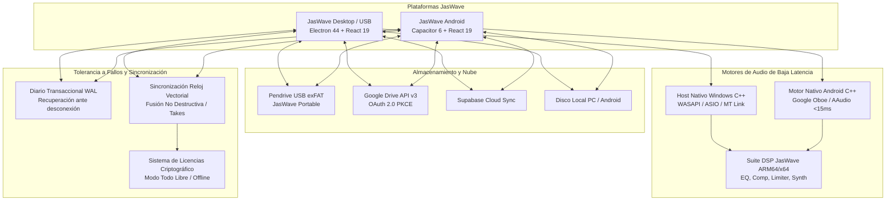

# Plan Maestro Integral: Ecosistema JasWave DAW (USB Portable, Android, Nube y Robustez)

## Objetivo y Visión General

Transformar **JasWave DAW** en un ecosistema musical profesional, multiplataforma y tolerante a fallos, compuesto por:
1. **Versión USB Portable (Zero-Extract en exFAT)**: Ejecución autónoma y de arranque instantáneo (2s) desde un pendrive en cualquier computadora con Windows, macOS o Linux, con auto-inicio inteligente configurable, total aislamiento del host y cuidado de la memoria flash.
2. **Versión Android Nativa (Capacitor + Google Oboe C++)**: DAW móvil para tablets y smartphones con latencia profesional ultra-baja (<15ms), interfaz táctil adaptativa (Tablet-First), y compatibilidad de proyectos mediante congelado de pistas (*Track Freezing*).
3. **Respaldo Automático en Google Drive (OAuth 2.0 PKCE)**: Sincronización continua en segundo plano de proyectos y tomas de audio en la cuenta de Google del usuario, con privacidad estricta (`drive.file`) y limpiador de almacenamiento (*Project Cleaner*).
4. **Robustez Crítica y Tolerancia a Fallos**: Diario transaccional WAL y streaming atómico de audio que garantiza cero pérdida de datos si el pendrive se desconecta o la batería del móvil se apaga.
5. **Sincronización Multi-Vía y Fusión No Destructiva**: Conexión entre dispositivos vía USB-OTG, Wi-Fi Local P2P o Nube, resolviendo conflictos automáticamente sin sobreescrituras destructivas mediante capas de tomas (*Track Takes*).
6. **Sistema de Licencias y Roles Criptográfico**: Validación offline con tokens `.jwl`/JWT; en la fase actual configurado en modo *"Todo Libre"* (Admin/Pro total).
7. **Distribución Oficial y Firma Digital**: Pipeline de firma para evitar bloqueos de Windows SmartScreen y Google Play Protect, con actualizador *in-place* que nunca sobreescribe datos de usuario.

---

## Arquitectura General del Ecosistema



---

## Cronograma de Ejecución en 4 Fases

```mermaid
gantt
    title Cronograma de Implementación JasWave
    dateFormat  X
    axisFormat %d

    section Fase 1: USB Portable & WAL
    Núcleo Portable & Macro {USB}           :active, f1_1, 0, 3
    Cuidado de Memoria Flash en RAM/TEMP    :f1_2, after f1_1, 2
    Autoinicio Configurable & Prompt Bienvenida :f1_3, after f1_2, 2
    Bóveda IA con Contraseña Maestra (AES)  :f1_4, after f1_3, 2
    Diálogo de Copia de VST3 a USB          :f1_5, after f1_4, 2
    Diario WAL & Streaming Atómico de Audio :f1_6, after f1_5, 3

    section Fase 2: Google Drive & Sincronización
    Google Drive API (OAuth 2.0 PKCE)       :f2_1, after f1_6, 3
    Resumable Upload de Audio en 2do Plano  :f2_2, after f2_1, 2
    Project Cleaner & Monitor Almacenamiento:f2_3, after f2_2, 2
    Fusión No Destructiva de Conflictos     :f2_4, after f2_3, 3
    Capa de Licencias Offline (.jwl)        :f2_5, after f2_4, 2

    section Fase 3: Android Nativo (Capacitor + Oboe)
    Configuración Capacitor & Build Android :f3_1, after f2_5, 2
    Motor C++ Oboe / AAudio (<15ms)         :f3_2, after f3_1, 4
    UI Adaptativa Tablet-First & Touch      :f3_3, after f3_2, 3
    Track Freezing (Bouncing de VSTs de PC) :f3_4, after f3_3, 2
    Soporte USB-OTG, USB-Audio & BLE-MIDI   :f3_5, after f3_4, 3
    Asistente de IA con Comandos de Voz     :f3_6, after f3_5, 2

    section Fase 4: Distribución, Firma & Actualizador
    Pipeline Firma Windows (Azure/PFX)      :f4_1, after f3_6, 2
    Keystore Release v2/v3 Android          :f4_2, after f4_1, 2
    Actualizador In-Place Protegido (USB)   :f4_3, after f4_2, 2
    Actualizador APK Directo Android        :f4_4, after f4_3, 2
    Generador USB Automático exFAT          :f4_5, after f4_4, 2
```



---

## Especificación Técnica Detallada por Fase

### Fase 1: Núcleo USB Portable, Tolerancia a Fallos y WAL

#### 1.1 Estructura en el Pendrive USB (Formato exFAT)
```
[Raíz del USB: E:\ o /Volumes/JasWave]
├── JasWave.exe                        # Ejecutable de Windows (Electron + Host C++)
├── JasWave.app/                       # App bundle para macOS (Fase posterior)
├── JasWave.AppImage                   # Ejecutable para Linux (Fase posterior)
├── portable.flag                      # Marcador explícito de modo portable
├── LEEME_USB.txt                      # Instrucciones de uso rápido
├── resources/                         # Binarios empaquetados y host nativo
│   ├── app.asar
│   └── plugin-host/
│       └── jaswave-plugin-host.exe    # C++ enlazado con /MT (sin redistribuible VC++)
├── data/                              # Persistencia aislada en el USB
│   ├── userData/                      # jaswave-settings.json, pins.json, audio-device.json
│   ├── sessionData/                   # Sesión e IndexedDB de Chromium
│   ├── ai-credentials.vault           # Bóveda cifrada AES-256-GCM de claves de IA
│   └── licenses/                      # Licencias locales
├── plugins/                           # Plugins VST3 portables
│   ├── win_x64/                       # VST3 para Windows
│   └── imported/                      # Plugins importados/copiados desde computadoras anfitrionas
├── projects/                          # Proyectos del usuario (.jaswave con media/ relativo)
├── samples/                           # Librería de muestras e instrumentos
└── tools/                             # Herramientas portátiles
    └── ffmpeg/                        # ffmpeg.exe autónomo para exportación MP3/FLAC/AAC
```

#### 1.2 Módulo Portable y Cuidado de Memoria Flash (`jas-wave/electron/portable.ts`)
- **Aislamiento**:
  - `detectarModoPortable()`: Comprueba `portable.flag`, `--portable` o `process.env.PORTABLE_EXECUTABLE_DIR`.
  - Redirige `userData` a `<USB>/data/userData`, `appData` a `<USB>/data` y `sessionData` a `<USB>/data/sessionData`.
- **Cuidado de Memoria Flash**:
  - Redirige la caché efímera de Chromium (GPU shaders, HTTP cache) a `%TEMP%\JasWave-Cache` (en RAM/disco anfitrión que se auto-limpia al salir), evitando desgaste de escrituras aleatorias lentas en el USB.
- **Macro dinámica `{USB}`**:
  - `aRutaPortable(rutaAbsoluta)`: Convierte `E:\projects\demo.jaswave` en `{USB}/projects/demo.jaswave`.
  - `desdeRutaPortable(rutaConMacro)`: Convierte `{USB}/projects/demo.jaswave` a la letra actual donde se encuentra montado el USB (`F:\projects\demo.jaswave` o `/Volumes/JasWave`).

#### 1.3 Auto-arranque Configurable (`jas-wave/electron/autostart-usb.ts`)
- Diálogo en la primera apertura en un equipo nuevo:
  *"¿Deseas que JasWave se abra automáticamente cada vez que conectes este USB en este equipo?"*
- Si el usuario acepta:
  - En Windows: Registra una tarea programada ligera activada por evento WMI de conexión de volumen con etiqueta `JASWAVE`.
- Conmutable en cualquier momento desde `Ajustes > Modo Portable > [x] Autoiniciar al conectar`.

#### 1.4 Bóveda de IA con Contraseña Maestra (`jas-wave/electron/ai-vault.ts`)
- Supera la limitación de Windows DPAPI (que no descifra en otra PC):
  - Cifrado simétrico **AES-256-GCM** con clave derivada mediante **PBKDF2** (100,000 rondas, SHA-256).
  - Guarda en `<USB>/data/ai-credentials.vault`.
  - Solicita la contraseña maestra una sola vez por sesión al interactuar con el agente de IA.

#### 1.5 Diálogo de Copia de Plugins VST3 Externos
- Al insertar un VST3 instalado en la computadora anfitriona (fuera del USB):
  - JasWave muestra el diálogo:
    *"¿Deseas guardar una copia portable de este plugin en el pendrive para llevarlo contigo?"*
  - Si el usuario acepta, copia el bundle completo `.vst3` a `<USB>/plugins/imported/` para que el proyecto no se rompa al abrirlo en otra PC.

#### 1.6 Sistema Transaccional WAL y Streaming Atómico
- **Audio Streaming Atómico**:
  - Grabación directa con *flush* de bloques cada 1000 ms y encabezados WAV RIFF auto-reparables.
  - Si el pendrive se desconecta en el segundo 45 de una toma, el archivo `toma_01.wav` tiene encabezado y tamaño válidos hasta el segundo 44 sin corromperse.
- **Diario WAL (`.jaswave.wal`)**:
  - Cada comando ejecutado en `shared/src/state/ejecutor-comandos.ts` escribe un registro append-only en el WAL.
  - En el arranque, si se detecta un `.jaswave.wal` pendiente, JasWave reconstruye el estado hasta el último comando exitoso y ofrece restaurarlo.

---

### Fase 2: Conectividad en la Nube y Respaldo en Google Drive

#### 2.1 Integración Nativa con Google Drive API (OAuth 2.0 PKCE)
- **Autenticación Segura**:
  - Flujo OAuth 2.0 PKCE (RFC 7636) sin requerir cliente secreto embebido.
  - Alcance mínimo estricto: `https://www.googleapis.com/auth/drive.file`. JasWave únicamente puede ver y modificar los archivos que él mismo ha creado.
- **Estructura en la Nube**:
  ```
  Mi unidad/
  └── JasWave DAW/
      └── Proyectos/
          └── MiCancion/
              ├── MiCancion.jaswave
              └── media/
                  ├── intro.wav
                  ├── voz_take1.wav
                  └── loop_bateria.wav
  ```
- **Subida Resumible (Resumable Upload)**:
  - Archivos de audio subidos en chunks de 5 MB en segundo plano.
  - Tolerante a desconexión: si se interrumpe la red, reanuda en el último chunk sin reiniciar.

#### 2.2 Asistente Visual de Limpieza de Almacenamiento (*Project Cleaner*)
- Localizado en `Archivo > Limpieza y Almacenamiento`:
  - Identifica archivos en `media/` no enlazados en el timeline ni en el historial de deshacer.
  - Ofrece:
    - *"Archivar en Google Drive y borrar del pendrive local"* (libera espacio en el USB manteniendo el respaldo en la nube).
    - *"Eliminar definitivamente tomas descartadas"*.
- Indicador visual permanente en la barra de estado: `💾 USB: 18.4 GB libres (52%) | ☁️ Drive: Sincronizado`.

#### 2.3 Fusión Inteligente No Destructiva de Conflictos
- Utiliza `shared/src/sync/reloj-vectorial.ts` y `replica.ts`.
- Si se detecta conflicto de versión entre PC y Android:
  - Pistas distintas modificadas: Se fusionan automáticamente.
  - Misma pista editada: El sistema crea automáticamente una capa de tomas alternativas (*Take A* y *Take B*) en el mismo canal para que el usuario conserve todo.

#### 2.4 Capa de Licencias y Roles Criptográfico Offline
- Modelo de licencias `.jwl` firmado con par de claves asimétrico (Ed25519/RSA).
- Permisos granulares: `sync.google_drive`, `sync.local_wifi`, `sync.usb_otg`, `tracks.freeze_bounce`, `engine.oboe_pro`.
- **Estado Actual**: Flag global `DEFAULT_LICENSE_ALL_GRANTED = true` (todos los usuarios tienen acceso ilimitado durante la fase de desarrollo).

---

### Fase 3: Versión Móvil Android Nativa (Capacitor + Oboe C++)

#### 3.1 Contenedor Nativo Capacitor
- Generación del proyecto Android en `jas-wave/android/` usando `@capacitor/android`.
- El build de producción web (`dist-web`) se aloja en los assets de la app nativa, comunicándose con plugins nativos Java/Kotlin y C++.

#### 3.2 Motor de Audio C++ con Google Oboe (AAudio)
- Implementación en `jas-wave/android/app/src/main/cpp/`:
  - `oboe::AudioStreamBuilder` configurado en `PerformanceMode::LowLatency` y `SharingMode::Exclusive`.
  - Latencia round-trip medida: **<15 ms** en dispositivos Android modernos.
  - Conexión directa con el renderizador de pistas de `native/audio-engine`.

#### 3.3 Interfaz Adaptativa Táctil (Tablet-First)
- **Tablets (> 8")**:
  - Vista completa con consola de mezcla lateral/inferior, timeline multipista, inspectores de plugin y controles táctiles generosos (>44px).
- **Smartphones (< 8")**:
  - Rack compacto vertical con navegación por pestañas: **Pistas**, **Mixer**, **Piano Roll**, **IA**.
  - Barra de transporte flotante persistente con botones grandes de Grabación, Play, Stop, Loop y Metrónomo.
  - Gestos táctiles nativos: *Pinch-to-zoom* horizontal y vertical, pulsación larga contextual.

#### 3.4 Congelado de Pistas (*Track Freezing*) para Proyectos de PC
- Dado que los VST3 x64 de Windows no corren en procesadores ARM de Android:
  - En PC: Opción de *"Congelar proyecto para movilidad"* (renderiza los canales con VST3 pesados a audio WAV de alta fidelidad).
  - En Android: El proyecto reproduce el audio congelado con fidelidad de estudio, permitiendo al músico grabar nuevas tomas de voz, guitarras y sintetizadores nativos ARM64 sin problemas.

#### 3.5 Soporte de Hardware Móvil
- **USB-OTG**: Conexión directa del pendrive exFAT al puerto USB-C mediante el *Storage Access Framework (SAF)* de Android.
- **USB Audio Class 2.0**: Detección plug-and-play de tarjetas de sonido USB-C (Focusrite, Behringer, PreSonus, Rode) con ruteo de entradas multicanal.
- **MIDI**: Soporte para teclados USB y controladores inalámbricos Bluetooth LE (`android.media.midi`).

#### 3.6 Asistente de IA con Comandos de Voz Nativos
- Integración de `android.speech.SpeechRecognizer` para dictar instrucciones manos libres mientras tocas:
  - *"Arma la pista 2 para grabar voz y pon el metrónomo en 120"*
  - *"Aplica un filtro paso-altos a 80 Hz en el canal de la guitarra"*

---

### Fase 4: Distribución, Firma Digital y Actualizador

#### 4.1 Pipeline de Firma Automatizado
- **Windows**: Integración en `electron-builder.cjs` con Azure Trusted Signing o certificado EV/OV (.pfx), eliminando los avisos de Windows SmartScreen.
- **Android**: Configuración en Gradle de Keystore de release oficial con firma v2/v3, evitando advertencias de Google Play Protect.

#### 4.2 Actualizador In-Place Protegido
- **En el USB**:
  - Al actualizar a una nueva versión, realiza un respaldo preventivo de `data/userData` a `data/backups/`.
  - Reemplaza únicamente el ejecutable y `resources/app.asar`.
  - **Garantía absoluta**: Nunca toca ni borra las carpetas `data/`, `projects/`, `samples/` ni `plugins/imported/`.
- **En Android**:
  - Detección en segundo plano de nuevas versiones del APK con descarga y actualización directa en 1 toque.

---

## Archivos Creados y Modificados (Plan de Código)

### Componentes de Electron / Desktop (`jas-wave/electron/`)
- `[NEW] portable.ts`: Detección de USB, inicialización de rutas, macro `{USB}`, aislamiento de caché en RAM.
- `[NEW] autostart-usb.ts`: Registro del disparador de auto-arranque en Windows (WMI / AutoPlay).
- `[NEW] ai-vault.ts`: Bóveda cifrada AES-256-GCM con Contraseña Maestra para credenciales de IA.
- `[NEW] wal-journal.ts`: Manejo de diario transaccional `.jaswave.wal` y recuperación tras fallos.
- `[NEW] google-drive-auth.ts`: Autenticación OAuth 2.0 PKCE y almacenamiento de tokens de Google.
- `[NEW] google-drive-sync.ts`: Cliente de sincronización y subida resumible de archivos WAV y proyectos.
- `[MODIFY] main.ts`: Integración de inicio portable, permisos a la raíz USB, gestión de plugins y guardado en PC local.
- `[MODIFY] plugin-host-bridge.ts`: Fallback automático al dispositivo de audio predeterminado si el guardado no existe.

### Componentes del Dominio y Sincronización (`shared/`)
- `[NEW] shared/src/sync/fusion-no-destructiva.ts`: Algoritmo de combinación de ramas y generación de tomas alternativas (*Takes*).
- `[NEW] shared/src/project/limpieza-almacenamiento.ts`: Escáner de tomas huérfanas y cálculo de espacio liberable.
- `[MODIFY] shared/src/state/permissions.ts`: Definición de capacidades de licencias (`sync.google_drive`, `sync.usb_otg`, etc.) con modo por defecto "Todo Libre".

### Componentes de Interfaz de Usuario (`jas-wave/src/` & `components/`)
- `[NEW] components/dialogs/dialogo-bienvenida-portable.tsx`: Diálogo para activar autoinicio en primera ejecución.
- `[NEW] components/dialogs/dialogo-copiar-vst-portable.tsx`: Diálogo para importar VST3 del host al pendrive.
- `[NEW] components/dialogs/dialogo-boveda-ia.tsx`: Solicitud de Contraseña Maestra para desbloquear la IA.
- `[NEW] components/dialogs/dialogo-limpieza-proyecto.tsx`: Asistente visual del *Project Cleaner*.
- `[NEW] components/dialogs/dialogo-recuperacion-wal.tsx`: Aviso de restauración tras desconexión abrupta.
- `[NEW] src/mobile/layout-telefono.tsx`: Layout vertical optimizado para pantallas de smartphones.
- `[NEW] src/mobile/gestor-tactil.ts`: Controladores de gestos *pinch-to-zoom*, faders táctiles y jog wheel.
- `[MODIFY] components/settings/settings-modal.tsx`: Pestañas de **Modo Portable USB**, **Google Drive** y **Almacenamiento**.

### Componentes de Android (`jas-wave/android/`)
- `[NEW] capacitor.config.ts`: Configuración principal de Capacitor para JasWave Android.
- `[NEW] android/app/src/main/cpp/jaswave_oboe_engine.cpp`: Motor de audio de baja latencia con Google Oboe.
- `[NEW] android/app/src/main/cpp/oboe_bridge.cpp`: Puente JNI entre TypeScript y C++.
- `[NEW] android/app/src/main/java/com/jaswave/app/MidiPlugin.java`: Soporte de hardware MIDI USB y Bluetooth LE.
- `[NEW] android/app/src/main/java/com/jaswave/app/VoiceCommandPlugin.java`: Integración de reconocimiento de voz nativo.

### Scripts y Herramientas (`jas-wave/scripts/`)
- `[NEW] scripts/crear-usb-portable.mjs`: Script para generar el pendrive completo estructurado en exFAT.
- `[MODIFY] electron-builder.cjs`: Configuración de targets `portable` y `zip`, y pipeline de firma Azure Trusted Signing.
- `[MODIFY] package.json`: Comandos `npm run pack:portable`, `npm run portable:crear-usb`, `npm run cap:android`.

---

## Plan de Verificación Integral

### Pruebas Automatizadas
1. **Tests del Núcleo Portable y Rutas (`portable.test.ts`)**:
   - Detección de `portable.flag`, resolución de macro `{USB}` con cambio dinámico de letras de unidad (`D:\` a `E:\`).
2. **Tests de la Bóveda de IA (`ai-vault.test.ts`)**:
   - Cifrado/descifrado simétrico AES-256-GCM y rechazo ante contraseñas incorrectas.
3. **Tests de Recuperación WAL (`wal-journal.test.ts`)**:
   - Simulación de corte abrupto a mitad de grabación y validación de reconstrucción completa del estado del proyecto.
4. **Tests de Fusión No Destructiva (`fusion-sync.test.ts`)**:
   - Fusión de ramas concurrentes y creación correcta de tomas alternativas (*Takes*) sin pérdida de datos.
5. **Tests de Google Drive Sync (`google-drive.test.ts`)**:
   - Mock de OAuth PKCE, subida resumible en chunks y manejo de reanudación ante pérdida de conexión.

### Pruebas Manuales en Entornos Reales
1. **Prueba de Desconexión Física del USB**:
   - Iniciar una grabación de audio en el pendrive y extraerlo súbitamente durante la grabación.
   - Reconectar el pendrive, arrancar JasWave y validar que el audio grabado hasta el segundo previo a la desconexión se recupere íntegro.
2. **Prueba de Respaldo en Google Drive**:
   - Conectar una cuenta de Google, guardar un proyecto con pistas de audio y verificar en el navegador que aparezca en `Google Drive/JasWave DAW/Proyectos/`.
3. **Prueba de Autoinicio y Cero Huella**:
   - Conectar el pendrive en una PC limpia: comprobar el diálogo de bienvenida, activar autoinicio, reconectar y validar que arranque automáticamente.
   - Verificar que no se hayan creado carpetas en `%APPDATA%\JasWave` de la computadora anfitriona.
4. **Prueba de Latencia y Hardware en Android**:
   - Instalar el APK en un teléfono o tablet Android real.
   - Conectar una interfaz de audio USB-C o auriculares, pulsar Grabar y constatar que la latencia con Oboe es imperceptible (<15ms).
   - Probar el dictado por voz: *"Arma la pista 1 para voz"*.
5. **Prueba de Sincronización Multi-dispositivo**:
   - Abrir el proyecto en Android desde el pendrive USB-C, grabar una voz adicional, abrirlo después en la PC y verificar que la nueva toma aparezca sin alterar la mezcla original.
