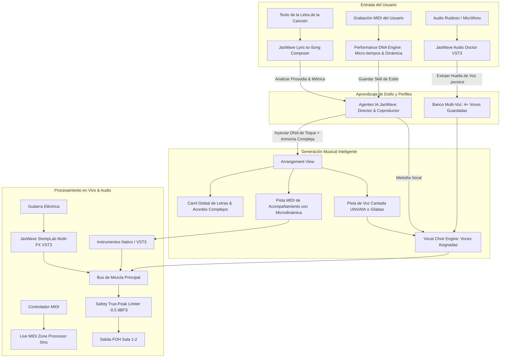

# Plan Maestro Definitivo: Ecosistema Integral JasWave
### (Compositor Letra-a-Canción, Timeline de Acordes Complejos, Banco Multi-Voz, Adiestramiento de Agentes con Microdinámica, Suite de Directo, StompLab y Audio Doctor)

## Resumen del Objetivo

Consolidar en JasWave la plataforma de producción musical, composición asistida y rendimiento en vivo más avanzada del mundo, articulada en 8 pilares interconectados:

1. **Carril Global de Letras y Acordes en el Arreglo (Timeline Lyric & Chord Lane)**:
   - Visualización sincronizada de la letra palabra por palabra directamente en la línea de tiempo del arreglo, con resplandor en tiempo real sobre el playhead.
   - Posicionamiento exacto de acordes armónicos complejos y basicos (`C`, `G`, `Am`, `F`, etc) y sus derivados (`Cmaj9`, `F#m7b5`, `Bb7(#11)`, `G7sus4(b9)`, `D/F#`) flotando sobre la sílaba precisa donde cambia la armonía.
2. **Módulo "JasWave Lyric-to-Song & Vocal Composer" con Entrevista IA y Extracción Vocal**:
   - **Entrevista Interactiva IA**: Al crear una canción, la IA guía al usuario en un flujo conversacional ágil (género musical objetivo y perfil de voz del banco multi-voz).
   - **Composición Asistida Dual (IA Autónoma o Voz Cantada del Usuario)**: Permite componer la melodía desde cero o activar la captura vocal donde el usuario canta o tararea su melodía al micrófono.
   - **Plugin / Motor de Análisis de Voz (f0 Tracking + AudioLens)**: Extrae con precisión microscópica las notas, el contorno de tono y el ritmo de la voz cantada, alineando automáticamente las sílabas de la letra sobre cada nota detectada.
   - **Afinación y Ritmo Asistido con Preescucha**: Controles deslizantes de *Corrección de Tono* y *Ajuste Rítmico* (0-100%) para afinar o preservar la naturalidad orgánica antes de volcar las notas.
   - **Armonización Creativa no-hardcodeada por LLM**: El modelo de lenguaje compone en tiempo de ejecución las progresiones armónicas ricas y complejas basadas en la tensión melódica y emoción poética (sin progresiones estáticas ni plantillas fijas).
   - **Producción y Organización en el DAW**: Pista vocal solista cantando la letra con la voz elegida, opción de coros armónicos polifónicos, acompañamiento instrumental y pista de referencia silenciada con el audio original del usuario.
3. **Plugin Vocal con Banco Multi-Voz (`JasWave Vocal Choir & Harmony Engine`)**:
   - Capacidad de perfilar, guardar y conmutar **múltiples voces de usuario** (*Voz Principal, Soprano, Barítono Profundo, Coros Femeninos, Voz Gospel*).
   - Genera coros polifónicos en el teclado MIDI cantados por tus propias voces con preservación de formantes (cero efecto pitufo) y armonizador en vivo para el micrófono.
4. **Motor de Adiestramiento de Agentes IA en Estilo Musical (Groove & Performance DNA Engine)**:
   - Los agentes de IA de JasWave aprenden tu forma única de tocar a partir de tus interpretaciones MIDI reales.
   - Analiza con precisión microscópica los **micro-tiempos** (desfases de milisegundos entre notas de acordes y arpegios), la **microdinámica** (velocidad MIDI individual de cada dedo dentro de un mismo acorde), el solapamiento legato, el ataque y el tempo rubato natural.
   - Aplica este ADN estilístico en las nuevas creaciones de canciones, haciendo que el piano, guitarra, bajo y cuerdas suenen exactamente con tu toque humano.
5. **"JasWave Neural Cleanse / Audio Doctor" (Restauración y Eliminación de Ruido de Clase Mundial)**:
   - Plugin VST3 universal con Diagnóstico Inteligente y botón **1-Click Auto-Fix** para audio grabado y micrófonos en vivo (< 2 ms de latencia).
   - 6 módulos quirúrgicos: *Spectral De-Noise*, *De-Hum* (50/60Hz), *De-Click*, *De-Reverb/De-Room*, *De-Clip* y *Voice/Dialogue Isolator*.
   - Audición **Delta (Solo Ruido)**, *Transient Shield* y *Air Recovery*.
6. **Pedalera Multi-FX Modular "JasWave StompLab" + Suite de Plugins FX Individuales**:
   - Contenedor con ranuras reordenables (Noise Gate, Compresor, Overdrive/Distorsión multi-modelo, Preamp de Válvulas, Cabina IR híbrida, Chorus/Mod, Smart Delay y Reverb Shimmer).
   - Disponibilidad de cada módulo como **plugin VST3 independiente**.
7. **Motor de Zonas MIDI y Suite de Directo (Zero-Disaster Live Shield)**:
   - Splits, capas y transposición con latencia 0 ms en C++.
   - Safety Limiter a -0.5 dBFS, botón PANIC de emergencia, *Seamless Patch Spillover* (colas sin cortes), pre-carga de samples en RAM y *Performance Lock Mode*.
8. **Compatibilidad Universal VST3 y Control 100% por IA**:
   - Todos los plugins son estándares VST3 de 64 bits para Windows compatibles con cualquier DAW (Reaper, Ableton, FL Studio, Cubase, etc.) y cuentan con telemetría IPC para ser gobernados en lenguaje natural por la IA de JasWave.

---

## 1. Carril Global de Letras y Acordes Complejos (Timeline Lyric & Chord Lane)

```
┌────────────────────────────────────────────────────────────────────────────────────────────────────────┐
│ COMPASES:  │ 1          │ 2               │ 3                 │ 4                 │ 5                  │
├────────────┴────────────┴─────────────────┴───────────────────┴───────────────────┴────────────────────┤
│ ESTRUCTURA: [=== VERSO 1 ========================================================] [=== CORO ========] │
├────────────────────────────────────────────────────────────────────────────────────────────────────────┤
│ ACORDES:   │ Cmaj9      │                  Em7(b13)           │ F#m7b5     B7(#9) │ Em9       A13(b9)  │
│ LETRA:     │ En  tu  pre- sen- cia      hay   plen- i- tud  de   go-           zo,  ante   tu   al- tar │
│ PLAYHEAD:  │            ▲ (Palabra activa iluminada en tiempo real)                                    │
├────────────────────────────────────────────────────────────────────────────────────────────────────────┤
│ PISTA VOCAL (PIANO ROLL CON SÍLABAS):                                                                  │
│            │ [En ] [tu ] [pre-] [sen-] [cia]                                                           │
├────────────────────────────────────────────────────────────────────────────────────────────────────────┤
│ PISTA ACOMPAÑAMIENTO: (Voicings profesionales con microdinámica del usuario aprendida)                 │
└────────────────────────────────────────────────────────────────────────────────────────────────────────┘
```

### Características del Lyric & Chord Lane
1. **Ubicación Estratégica**:
   - Se sitúa en la cabecera superior del Arrangement View (justo debajo de la regla métrica de compases y la pista de marcadores/secciones).
2. **Sincronización Silábica y Resplandor Reactivo**:
   - Cada palabra se desglosa en sílabas fonéticas alineadas a los pulsos (beats).
   - Al reproducir la canción, la palabra activa emite un resplandor luminoso suave (*glow*) al compás del playhead.
3. **Soporte Armónico Ilimitado para Acordes Complejos**:
   - La IA y el motor armónico manejan todo el espectro de armonía moderna:
     - Tríadas mayores, menores, aumentadas y disminuidas.
     - Séptimas: `Maj7`, `m7`, `7`, `m7b5`, `dim7`, `m(maj7)`.
     - Extensiones y tensiones: `add9`, `maj9`, `9`, `11`, `#11`, `13`, `b13`, `7(#9)`, `7(b9)`.
     - Suspendidos: `sus2`, `sus4`, `7sus4`.
     - Inversiones y notas de bajo sobre línea (*slash chords*): `C/E`, `G/B`, `D/F#`, `Bb/D`.
4. **Edición Interactiva**:
   - Doble clic en cualquier acorde o palabra para modificarla.
   - Arrastre horizontal para desplazar el momento exacto en que entra una frase o un acorde.

---

## 2. Módulo "JasWave Lyric-to-Song & Vocal Composer"

### 2.1. Arquitectura y Flujo de la Entrevista Interactiva (Modo Híbrido)

El proceso de creación no es un formulario rígido ni un simple prompt estático; se articula a través de un **flujo híbrido** que combina la agilidad conversacional del Chat de IA de JasWave con la precisión quirúrgica de una ventana modal visual dedicada para la captura vocal y la alineación lírica.

```
┌────────────────────────────────────────────────────────────────────────────────────────┐
│                        FLUJO HÍBRIDO DE COMPOSICIÓN ASISTIDA                           │
├────────────────────────────────────────────────────────────────────────────────────────┤
│                                                                                        │
│  [ 1. CHAT DE IA: ENTREVISTA RÁPIDA ]                                                  │
│    • El usuario pega o redacta la letra.                                               │
│    • La IA pregunta: Género deseado (*Worship, Balada, R&B, etc.*) y Voz del Banco.    │
│    • Decisión de Melodía: ¿IA compone melodía autónoma O cantar/tararear melodía?      │
│                                                                                        │
│                                    │ (Si elige Cantar/Tararear)                        │
│                                    ▼                                                   │
│  [ 2. MODAL VISUAL: JASWAVE VOICE-TO-MELODY & LYRIC ALIGNMENT PANEL ]                  │
│    • Grabación de toma vocal (con clic/metrónomo) o importación de audio.              │
│    • Pitch Tracking f0 + Detección de transitorios y notas MIDI.                       │
│    • Mapeo silábico de la letra sobre las notas (canto real o humming "la-la-la").     │
│    • Sliders de afinación asistida (0-100%) y cuantización con preescucha A/B.         │
│                                                                                        │
│                                    │ (Confirmar Melodía & Letra)                       │
│                                    ▼                                                   │
│  [ 3. ARMONIZACIÓN CREATIVA POR LLM (SIN PLANTILLAS FIJAS) ]                           │
│    • El LLM evalúa la emoción lírica y la tensión de cada nota melódica cantada.       │
│    • Genera en tiempo de ejecución progresiones complejas ricas en tensiones.          │
│                                                                                        │
│                                    │ (Generación en DAW)                               │
│                                    ▼                                                   │
│  [ 4. VOLCADO MULTI-PISTA EN EL ARREGLO ]                                              │
│    • Timeline Lyric & Chord Lane (letras iluminadas + acordes flotantes).              │
│    • Pista Vocal Lead sintetizada cantando la letra exacta con la voz seleccionada.    │
│    • Pista de Coros Armónicos opcional (segundas voces en clímax).                     │
│    • Pistas Instrumentales (Piano, Pads, etc.) con Groove DNA del usuario.             │
│    • Pista de Audio de Referencia (canto real original silenciado para A/B).           │
└────────────────────────────────────────────────────────────────────────────────────────┘
```

### 2.2. Panel Visual de Captura y Alineación Vocal (`JasWave Voice-to-Melody Panel`)

```
┌────────────────────────────────────────────────────────────────────────────────────────┐
│  JASWAVE VOICE-TO-MELODY & LYRIC ALIGNMENT ENGINE                                  [✖] │
├────────────────────────────────────────────────────────────────────────────────────────┤
│  TOMA VOCAL: [ 🎙 REC ] [ ⏹ STOP ] [ ▶ AUDICIÓN ]   TEMPO: [ 72 BPM ]  METRÓNOMO: [ON]  │
│                                                                                        │
│  FORMA DE ONDA & NOTAS DETECTADAS:                                                     │
│  ┌──────────────────────────────────────────────────────────────────────────────────┐  │
│  │ ~~~/\~~~ (Audio original)                                                        │  │
│  │  [ D4 ]───────[ E4 ]────────[ F#4 ]─────────────[ G4 ]────────[ A4 ]             │  │
│  │  "En"        "tu"          "pre-"              "sen-"        "cia"               │  │
│  └──────────────────────────────────────────────────────────────────────────────────┘  │
│                                                                                        │
│  MODO DE ENTRADA:  (●) Canto con Letra Real      (○) Tarareo / Humming ("la-la-la")    │
│                                                                                        │
│  CONTROLES DE ASISTENCIA:                                                              │
│  • Corrección de Tono (Pitch Snap):  [ 75% ]  (Escala detectada: D Mayor Natural)      │
│  • Ajuste Rítmico (Quantize Grid):   [ 60% ]  (Rejilla 1/16 con swing natural)         │
│  • Dinámica y Expresión Humana:      [ 90% ]  (Mantiene vibrato y crescendo orgánico)  │
│                                                                                        │
│  LEAD & COROS: [✓ Generar Coros Armónicos en Estribillo]  VOZ: [ Mi Voz Lead Barítono ▼]│
│                                                                                        │
│  [ ▶ ESCUCHAR CON VOZ SINTETIZADA ]        [ 📥 CREAR CANCIÓN Y VOLCAR AL PROYECTO ]   │
└────────────────────────────────────────────────────────────────────────────────────────┘
```

### 2.3. Especificaciones Técnicas del Proceso

1. **Entrevista Ágil y Cero Fricción**:
   - En el chat de IA, el usuario solo necesita definir:
     - El texto/letra inicial (o pedirle a la IA que la redacte a partir de un tema).
     - El género musical (*Worship Contemporáneo, Balada Pop, R&B Soul, Góspel*, etc.).
     - El perfil de voz deseado de su biblioteca `.jwvoice`.
     - Si desea que la IA invente la melodía o si prefiere **cantarla él mismo** en el micrófono.
2. **Modos de Entrada Vocal**:
   - **Canto con Letra Real**: El sistema utiliza alineación fonética de transitorios para sincronizar cada palabra y sílaba de la letra con las notas cantadas en tiempo real.
   - **Tarareo / Humming ("la-la-la", "mmm", silbidos)**: Si el usuario tararea sin pronunciar las palabras, el motor distribuye inteligentemente las sílabas del texto introducido sobre las notas y pausas respiratorias detectadas.
3. **Afinación y Ritmo Asistido con Preescucha**:
   - **Pitch Tracking Quirúrgico**: Basado en algoritmos f0 de alta resolución (`extraerMelodiaMidiDeAudio`), analiza frecuencia fundamental, vibrato y cambios de nota.
   - **Controles Deslizantes Interactivos**: El usuario puede ajustar qué tan estricta es la corrección de tono (desde 0% orgánico hasta 100% afinación perfecta) y la alineación rítmica antes de volcar las notas a la línea de tiempo.
   - **Preescucha Inmediata**: Permite escuchar las notas resultantes cantadas por el motor de síntesis antes de cerrar el panel.
4. **Armonización Creativa no-hardcodeada por LLM**:
   - **Prohibición de Progresiones Estáticas**: Quedan descartadas las ruedas de acordes genéricas o secuencias hardcodeadas fijas (como simples `I - V - vi - IV`).
   - **Composición Contextual en Tiempo de Ejecución**: El LLM analiza la letra completa, el peso emocional de cada verso y las notas cantadas por el usuario.
   - **Tensión Melódica y Conducción de Voces**: Cada nota de la melodía se evalúa dentro del campo armónico como fundamental, 3ra, 5ta, 7ma, 9na, #11 o 13na, generando progresiones con acordes complejos (`Cmaj9`, `F#m7b5`, `Bb7(#11)`, `G7sus4(b9)`, `D/F#`), intercambios modales y sustituciones armónicas elegantes.
5. **Estructura y Organización de Pistas en el DAW**:
   - **Timeline Lyric & Chord Lane**: Se puebla con las palabras alineadas al beat y los acordes calculados flotando exactamente sobre la sílaba del cambio de armonía.
   - **Pista Vocal Principal (Lead Voice)**: Clip MIDI con articulación silábica cantando la letra con la voz seleccionada del banco.
   - **Pista de Coros Armónicos (Opcional)**: Capas de segundas y terceras voces polifónicas en las secciones de mayor intensidad.
   - **Pistas Instrumentales**: Piano acústico, pads o guitarras interpretando los acordes con el toque humano y microdinámica aprendida del usuario (*Groove DNA*).
   - **Pista de Audio de Referencia (Muted)**: El audio original grabado con la voz del usuario se guarda en una pista de audio silenciada (`[Audio Ref - Canto Original]`), permitiendo contrastar la fuente original con la producción generada en cualquier momento.

---

## 3. Plugin Vocal con Banco Multi-Voz (`JasWave Vocal Choir Engine`)

```
┌────────────────────────────────────────────────────────────────────────────────────────┐
│  JASWAVE VOCAL CHOIR & HARMONY ENGINE               [ BANCO MULTI-VOZ: 4 VOCES ]  [💾] │
├────────────────────────────────────────────────────────────────────────────────────────┤
│  PERFILES DE VOZ GUARDADOS:                                                            │
│  [● Voz 1: Mi Voz Lead (Barítono Cálido)]   [○ Voz 2: Coro Soprano Femenino]          │
│  [○ Voz 3: Voz Tenor Worship con Aire]      [○ Voz 4: Bajo Vocal Gospel Profundo]     │
├────────────────────────────────────────────────────────────────────────────────────────┤
│  ASIGNACIÓN DE VOCES A LA ARMONÍA:                                                     │
│  • Melodía Principal (Lead): [ Voz 1: Mi Voz Lead ▼ ]          Vol: 0.0 dB  Pan: Centro│
│  • Segunda Voz (+3ra Mayor): [ Voz 3: Voz Tenor con Aire ▼ ]   Vol: -3.0 dB Pan: 35% L │
│  • Tercera Voz (+5ta Justa): [ Voz 2: Coro Soprano ▼ ]         Vol: -3.0 dB Pan: 35% R │
│  • Base Grave (-1 Octava):   [ Voz 4: Bajo Vocal Gospel ▼ ]    Vol: -4.5 dB Pan: Centro│
├────────────────────────────────────────────────────────────────────────────────────────┤
│  CONTROLES DE CALIDAD: [✓ PRESERVACIÓN DE FORMANTES] [ SPREAD ESTÉREO 3D: 85% ]       │
└────────────────────────────────────────────────────────────────────────────────────────┘
```

### Características del Banco Multi-Voz
1. **Gestión de Múltiples Perfiles de Voz**:
   - Permite almacenar decenas de perfiles tímbricos `.jwvoice` en la biblioteca del usuario.
   - Puede capturar voces reales de diferentes cantantes o generar variaciones estilizadas a partir de una única voz (modificando formantes, aspereza, brillo y resonancia de pecho/cabeza).
2. **Coros Polifónicos Multitímbricos**:
   - En lugar de que todas las notas del coro suenen con el mismo tono idéntico, cada voz de la armonía (soprano, tenor, alto, bajo) puede tener asignada una voz diferente del banco para un realismo coral absoluto.
3. **Armonizador en Tiempo Real para Micrófono**:
   - Mientras cantas en vivo, el plugin genera coros instantáneos con las voces seleccionadas guiadas por las notas del teclado MIDI o la escala activa.

---

## 4. Motor de Adiestramiento de Agentes IA en Estilo Musical (Groove & Performance DNA Engine)

Para garantizar que las creaciones de la IA no suenen robóticas ni genéricas, los agentes de JasWave se adiestran analizando tus grabaciones MIDI reales con resolución de micro-segundos:

```
┌────────────────────────────────────────────────────────────────────────────────────────┐
│  EXTRACCIÓN DE ADN DE INTERPRETACIÓN (PERFORMANCE DNA)                                 │
├────────────────────────────────────────────────────────────────────────────────────────┤
│  CLIP ANALIZADO: "Worship Piano Solo - Toma 2"                                         │
│                                                                                        │
│  1. MICRO-TIMING (Desfases entre dedos en acordes):                                   │
│     • Nota Bajo: +0.0 ms (Referencia de pulso)                                         │
│     • Nota Media (3ra): +8.4 ms (Ataque rodado suave)                                  │
│     • Nota Melodía (9na): +14.2 ms (Entrada cantabile retrasada expresiva)             │
│                                                                                        │
│  2. MICRODINÁMICA (Velocidad MIDI individual por dedo dentro del mismo acorde):       │
│     • Mano Izquierda (Bajo fundamental): Velocity 84                                   │
│     • Mano Derecha (Armonía interna): Velocity 68 (Toque suave para no ensuciar)       │
│     • Mano Derecha (Voz melódica superior): Velocity 96 (Canta por encima de la masa)  │
│                                                                                        │
│  3. ARTICULACIÓN Y RUBATO:                                                             │
│     • Legato Overlap: 28 ms de solapamiento natural entre notas sucesivas              │
│     • Curva de Rubato: -4% BPM en caídas de cadencia al final de cada 4 compases       │
├────────────────────────────────────────────────────────────────────────────────────────┤
│  [ 💾 GUARDAR COMO SKILL DE ESTILO: "Mi Estilo Worship Personal" ]                     │
└────────────────────────────────────────────────────────────────────────────────────────┘
```

### Cómo Utilizan este Adiestramiento los Agentes
1. **Almacenamiento en el Repositorio de Agentes (`ai-harness`)**:
   - El perfil se guarda como una habilidad de estilo formal (`SkillEstiloInterpretacion`) accesible para todos los roles de agentes (*Director, Coproductor, Pianista, Guitarrista*).
2. **Inyección en Nuevas Creaciones**:
   - Cuando pides componer una melodía o acompañamiento para una letra:
     - La IA no coloca notas rígidas en la cuadrícula (*grid*).
     - Aplica tus **micro-tiempos exactos** al tocar acordes y arpegios.
     - Aplica tus **relaciones de microdinámica** (diferenciando la fuerza de la melodía frente a los acordes internos).
     - Modela el tempo y las respiraciones según tu forma real de tocar.

---

## 5. Arquitectura Global Integrada



---

## 6. Plan de Implementación por Fases

### Fase 1: Motor de Letras, Acordes Complejos y Timeline Lane
- Definición de tipos en `shared/src/types/lyrics.ts`: estructuras `LyricPhrase`, `LyricSyllable`, `ComplexChordEvent` (soporte completo de 7mas, 9nas, 11nas, 13nas, aumentados, disminuidos, slash chords).
- Creación del componente `TimelineLyricChordLane.tsx` en `jas-wave/components/arrangement/`:
  - Regla visual superior debajo de los compases.
  - Sincronización con el playhead mediante resplandor reactivo.
  - Insignias de acordes flotantes con edición por doble clic.

### Fase 2: Motor de Adiestramiento de Agentes (Performance DNA)
- `shared/src/ai/performance-dna-analyzer.ts`:
  - Algoritmo de detección de micro-tiempos (desfases intencionales de notas en acordes).
  - Algoritmo de microdinámica (balance de velocity relativo entre dedos de una misma mano).
  - Extracción de solapamiento legato y curvas de tempo rubato.
- Persistencia de Skills de Estilo en `ai-harness/src/agent/skills/`.

### Fase 3: Compositor de Letra-a-Canción y Banco Multi-Voz
- Panel `LyricToSongComposer.tsx` en `jas-wave`:
  - Entrada de texto de letra, selección de estilo de usuario aprendido y género.
  - Comandos de dominio `lyrics.composeSong`, `lyrics.alignTiming`, `lyrics.setChords`.
- Expansión de `JasWave Vocal Choir Engine`:
  - Banco Multi-Voz con soporte de múltiples archivos `.jwvoice`.
  - Articulación vocal dual: Vocalizaciones ("Uhh / Ahh / Mmm") y modulación silábica.

### Fase 4: Restauración de Audio, StompLab y Suite de Directo
- `JasWave Audio Doctor VST3`: Diagnóstico inteligente, 1-Click Auto-Fix, 6 módulos quirúrgicos y modo Live Mic (< 2 ms).
- `JasWave StompLab VST3`: Pedalera modular multi-FX y plugins individuales.
- Sistema Universal de Presets para todos los plugins.
- Zonas MIDI a 0 ms y blindaje de audio en escenario.

---

## 7. Plan de Verificación y Demostración en Video

### Tests Automatizados
1. **Tests de análisis de Performance DNA**:
   ```bash
   cd shared && npm test src/test/performance-dna.test.ts
   ```
   - Validar extracción exacta de micro-desfases y balances de velocity nota a nota.
2. **Tests de generación de acordes complejos**:
   ```bash
   cd shared && npm test src/test/complex-chords.test.ts
   ```
   - Validar reconocimiento y generación de tensiones (`Cmaj9`, `F#m7b5`, `Bb7(#11)`, `G7sus4(b9)`, `D/F#`).
3. **Tests de sincronización de letras**:
   ```bash
   cd shared && npm test src/test/lyric-lane.test.ts
   ```
   - Validar silabeo métrico y cálculo temporal compás a compás.
4. **Verificación global del proyecto**:
   ```bash
   npm run verify
   ```

### Verificación Manual con Grabación de Video en Navegador
- Utilizaremos la herramienta `browser_subagent` para:
  1. Abrir la interfaz web de JasWave (`http://localhost:5173`).
  2. Pegar una letra de ejemplo en el *Lyric-to-Song Composer*.
  3. Comprobar cómo la IA genera el arreglo, visualiza las palabras iluminándose en el *Lyric & Chord Lane*, ubica los acordes complejos y activa el sintetizador vocal.
  4. La sesión se grabará automáticamente en video `.webp` para que el usuario pueda visualizar todo el flujo como si lo estuviese utilizando en persona.
