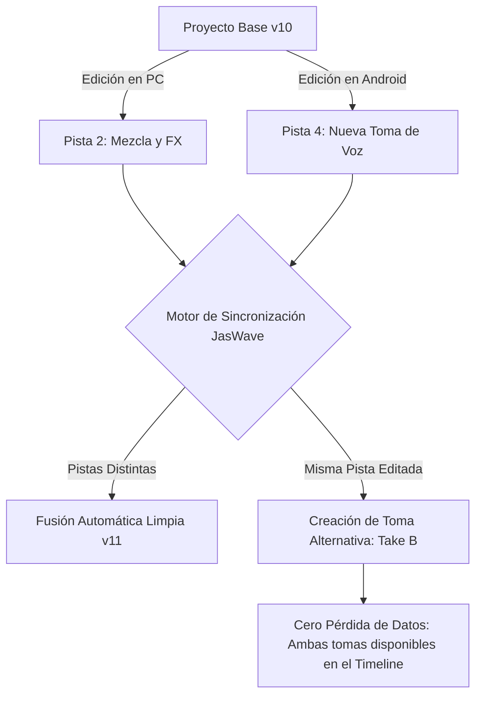
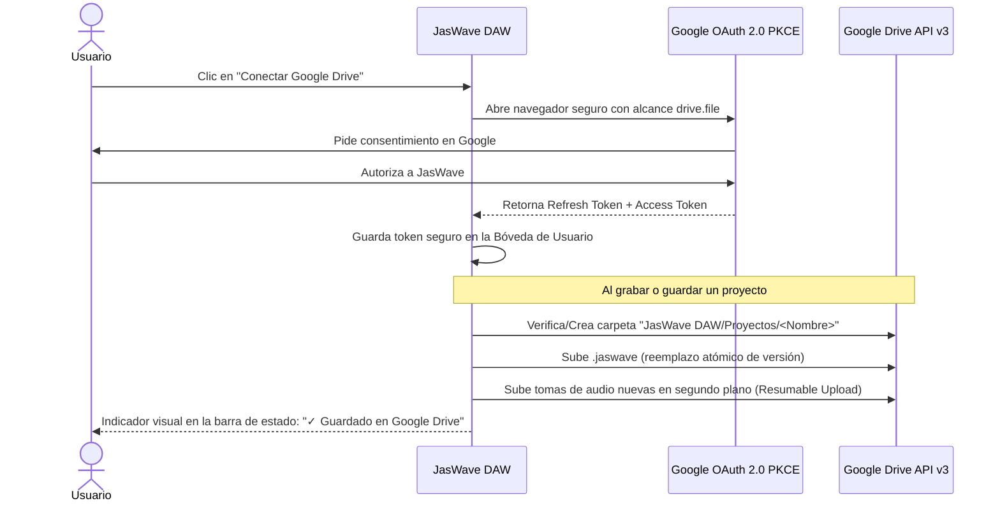

# Plan de Implementación: Robustez, Distribución y Google Drive en JasWave DAW

## Objetivo y Contexto

Asegurar que la arquitectura de **JasWave DAW** (en sus versiones **USB Portable**, **Desktop** y **Android**) sea de grado profesional, tolerante a fallos críticos de hardware (desconexión súbita de pendrives, cortes de batería), libre de conflictos de sincronización destructivos, con gestión eficiente del almacenamiento, firma digital de seguridad y **respaldo automático continuo en la cuenta de Google Drive del usuario**.

---

## 1. Protección de Datos ante Desconexión Abrupta (WAL y Transacciones)

### El Problema
Al trabajar desde una memoria USB o un teléfono móvil, existe el riesgo inminente de:
- Tirón accidental del cable o extracción del pendrive mientras se graban tomas de audio.
- Apagado repentino del teléfono por batería agotada o cierre por el *Low Memory Killer* de Android.
- Un guardado tradicional en caliente que sobreescribe directamente el archivo `.jaswave` puede dejar el archivo a medio escribir (0 bytes o JSON corrupto), perdiendo todo el proyecto.

### Solución: Sistema Transaccional con Diario WAL (Write-Ahead-Log)
1. **Grabación de Audio en Streaming Atómico**:
   - Los buffers de audio entrantes de micrófono/instrumento no se escriben directamente al archivo final: se escriben con flush de bloques cada 1000 ms con encabezado RIFF WAV válido en tiempo real.
   - Si se desconecta el pendrive, el archivo `.wav` grabado hasta ese último segundo es un archivo de audio perfectamente reproducible y cerrado.
2. **Diario WAL para el Estado del Proyecto (`.jaswave.wal`)**:
   - Cada comando ejecutado en el DAW se registra como una entrada incremental en un archivo auxiliar `.jaswave.wal`.
   - El archivo principal `.jaswave` se consolida mediante reemplazo atómico (`atomic-write.ts` con rename seguro en el mismo sistema de archivos).
   - **Protocolo de Recuperación en el Inicio**:
     - Al abrir JasWave, comprueba si existe un `.jaswave.wal` sin consolidar.
     - Muestra un aviso de recuperación: *"Se detectó una sesión no cerrada correctamente. Se han recuperado todos tus cambios y tomas grabadas."*

---

## 2. Resolución No Destructiva de Conflictos de Sincronización

- **Basado en Reloj Vectorial (`shared/src/sync/reloj-vectorial.ts`)**:
  - Cada modificación tiene identificador de nodo (`pc-desktop` vs `android-mobile`), marca de tiempo y versión vectorial.
- **Regla de Oro: Cero Pérdida de Datos**:
  - Si los cambios ocurrieron en pistas diferentes: se fusionan de forma automática e invisible.
  - Si dos dispositivos editaron la misma pista o grabaron en el mismo compás: el sistema crea automáticamente una capa de tomas (*Track Takes / Playlists*), colocando la versión de Android como *Take B* y la de PC como *Take A*, permitiendo al usuario escuchar ambas y elegir la mejor toma.

---

## 3. Integración Nativa con Google Drive (OAuth 2.0 PKCE)

### Cómo Funciona
El usuario conecta su propia cuenta de Google una sola vez en el DAW (en PC, USB o Android) y JasWave respalda automáticamente sus sesiones en la nube.

### Privacidad y Seguridad Estricta
- **Alcance Restringido (`https://www.googleapis.com/auth/drive.file`)**:
  - JasWave **NO** tiene acceso a los documentos, fotos ni archivos personales del usuario en su Google Drive.
  - Solo tiene acceso a los archivos y carpetas que el propio JasWave crea en `Mi unidad/JasWave DAW/`.
- **Subida Eficiente (Resumable Upload Chunking)**:
  - Los archivos de audio WAV pueden pesar 50 MB - 500 MB. La subida se realiza por bloques de 5 MB en segundo plano sin congelar la interfaz ni interrumpir la reproducción de audio.
  - Si se pierde la conexión a internet, se reanuda automáticamente en cuanto se restablece la red.

---

## 4. Gestión de Almacenamiento y Flexibilidad de Ubicación

### Guardado Local en la Computadora Anfitriona
Aunque el programa se ejecute desde la memoria USB:
- El diálogo de guardado ofrece ubicaciones claras:
  - `📁 Mi Pendrive (USB)` (por defecto)
  - `💻 Esta Computadora` (`C:\Users\<Usuario>\Music\JasWave` en Windows, `/storage/emulated/0/Music` en Android).
  - `☁️ Mi Google Drive`
- Botones de acción rápida en el proyecto:
  - *"Respaldar este proyecto en la computadora"*
  - *"Mover este proyecto al pendrive USB"*

### Asistente Visual de Limpieza (*Project Cleaner*)
- Localizado en `Archivo > Limpieza y Almacenamiento`:
  1. Analiza todos los archivos de `media/`.
  2. Identifica tomas no utilizadas (grabaciones fallidas que ya no están en ninguna pista ni en el historial de deshacer).
  3. Muestra el resumen: *"18 tomas descartadas encontradas (ocupan 1.1 GB en el USB)"*.
  4. Permite:
     - **Archivar en Google Drive y liberar espacio local**: Sube las tomas descartadas a la carpeta de archivo en Drive y las borra del pendrive.
     - **Eliminar definitivamente del pendrive**.
- Monitor en la barra de estado: Muestra constantemente el porcentaje y gigabytes libres del pendrive (`💾 USB: 14.2 GB libres (45%)`).

---

## 5. Actualizador "In-Place" Protegido

### En la Memoria USB
- Al detectar una nueva versión en línea:
  1. Descarga el paquete de actualización en `%TEMP%`.
  2. Realiza un respaldo preventivo de la configuración: `data/userData/` se comprime en `data/backups/pre-update-vX.Y.Z.zip`.
  3. Reemplaza únicamente el archivo ejecutable (`JasWave.exe`), `resources/app.asar` y los binarios nativos del motor.
  4. Las carpetas `data/`, `projects/`, `samples/` y `plugins/imported/` quedan **100% intactas**.

### En Android
- La app comprueba en segundo plano si existe una versión más reciente.
- Ofrece el diálogo: *"Nueva versión disponible (v0.2.0). ¿Deseas actualizar ahora?"*.
- Descarga el nuevo APK y lanza el instalador nativo de Android mediante el `FileProvider` con un solo toque.

---

## 6. Pipeline de Firma Digital y Confianza de Antivirus

| Plataforma | Mecanismo de Firma | Evita |
| :--- | :--- | :--- |
| **Windows x64** | **Azure Trusted Signing** o Certificado EV/OV (.pfx) integrado en `electron-builder.cjs` | Bloqueos de Windows Defender SmartScreen ("Windows protegió su PC"). |
| **Android APK** | **Keystore de Release oficial (v2/v3 signing scheme)** vía Gradle | Alertas rojas de Google Play Protect al instalar el APK. |
| **macOS (Fase 2)** | **Apple Developer ID + Notarización `altool`/`notarytool`** | Bloqueos de macOS Gatekeeper ("No se puede abrir porque el desarrollador no está verificado"). |

---

## Plan de Verificación

1. **Prueba de Resistencia a Desconexión (Crash Recovery)**:
   - Iniciar una grabación de audio de 30 segundos.
   - En el segundo 15, forzar el cierre del proceso (`taskkill /F /IM electron.exe`) o desconectar el pendrive USB.
   - Volver a conectar el pendrive y arrancar JasWave.
   - Verificar que el diálogo de recuperación aparezca y que el audio grabado hasta el segundo 14 se reproduzca perfectamente.
2. **Prueba de Subida a Google Drive**:
   - Iniciar sesión con Google Drive desde el diálogo de ajustes.
   - Crear un proyecto con una pista de audio y guardarlo.
   - Abrir Google Drive en el navegador y constatar que en `Mi unidad/JasWave DAW/Proyectos/...` existan el archivo `.jaswave` y el audio `.wav`.
3. **Prueba de Fusión de Conflictos (PC vs Android)**:
   - Simular dos ramas con `reloj-vectorial`: una con cambios en pista 1 y otra con cambios en pista 2.
   - Comprobar que la sincronización una ambas pistas sin errores.
4. **Prueba de Limpieza de Almacenamiento**:
   - Grabar 3 tomas y borrar 2 de la línea de tiempo.
   - Abrir el *Project Cleaner* y verificar que reporte con precisión las 2 tomas huérfanas y libere los megabytes esperados al confirmar la limpieza.
