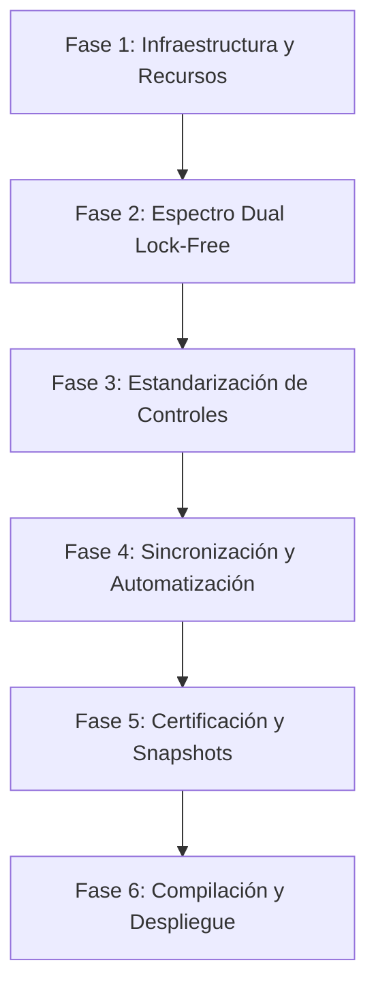

# V3 — Diseño Unificado Futurista, Espectro Dual y Sincronización en Tiempo Real de Plugins VST

**Depende de:** V1, V2, L2  
**Fuente:** [DESIGN.md](file:///c:/src/jaswave-ia/plugins/shared-ui/DESIGN.md), Documento Maestro V5 y auditoría exhaustiva del repositorio JasWave (2026-10-23).

## Estado de implementación (2026-10-23)

**Parte nativa (Windows): hecha.** La parte web (réplica Canvas responsiva y táctil, sincronización
`plugin.parametro.cambiado`) es el workstream **V4**.

| Requisito | Dónde | Verificación |
|---|---|---|
| Plantilla única: zonas, rejilla 3×2, SALIDA con bypass en la píldora, fader y medidores IN/OUT en x=976 | `plugins/shared-ui/jw_ui_plantilla.h` | `node plugins/scripts/ui-layout.mjs` (7 layouts idénticos en zonas) |
| Logo embebido (RCDATA + WIC, 28 px) | `shared-ui/jaswave_resources.rc`, `Gfx::logo` | capturas |
| Espectro IN/OUT en los 5 efectos y OUT + MIDI en los 2 instrumentos | `MeterBusBase::espIn/espOut`, `entrada()/salida()` | `jw_dsp_selftest` [V3] |
| Coste cero con el editor cerrado (taps, scope y vectorscopio) | `MeterBusBase::editoresAbiertos` | `jw_dsp_selftest` [V3] |
| Balística 14 dB/s por tiempo real (espectros y medidores) | `SpectrumAnalyzer::updateBalistica`, `Kit::PeakFollower` | `jw_dsp_selftest` [V3] |
| Escala −120..0 dBFS, 20 Hz–20 kHz, IN 1 px + 8 %, OUT 1.8 px con halo + 15 % | `Plantilla::EspectroDual` | capturas |
| Acentos: ámbar (comp), amarillo (limiter), verde-cian (de-esser), violeta (roles), cian (resto) | `PluginEditor::accent()` | `ui-layout.json` → `acento` |
| Sin cadenas por frame (claves de texto por hash, valores cacheados) y polilíneas en una geometría | `jw_ui_gfx.cpp`, `jw_ui_widgets.cpp` | revisión |
| Táctil (WM_POINTER, área 44 px, pulsación larga = valor numérico) y DPI dinámico | `jw_ui_view.cpp` | manual (pantalla táctil) |
| 5 estados de licencia en capturas: válida, por vencer, básica, sin licencia, activando | `jw_snapshot_main.cpp` | `plugins/docs/capturas` (35 PNG) |
| Layout exportable para la réplica web | `<Target>_snapshot.exe --dump-layout` → `plugins/<id>/ui-layout.json` | `ui-layout.mjs --check` / `--validar` |

Correcciones a este documento: el ejecutable de capturas es `<Target>_snapshot.exe` (no existe
`jw_snapshot_main.exe`); el despliegue de desarrollo va a `%LOCALAPPDATA%\Programs\Common\VST3\JasWave`;
el generador por defecto es Visual Studio 2022 (2026 opcional). Pendiente fuera de V3: `pluginval`
(no instalado en esta máquina) y la réplica web (V4).

---

## 1. Resumen Ejecutivo

Este plan establece la directriz maestra de ingeniería e interfaz para unificar la estética futurista/cyber en los **7 plugins VST3 nativos** de JasWave (`plugins/`), garantizando:

1. **Lenguaje visual y componentes unificados:** Perillas circulares (`Knobs`), barras de movimiento verticales (`Faders`), conmutadores de píldora (`Toggles`), selectores escalonados (`Dropdowns`) y marco metálico achaflanado con iluminación LED lateral y de rejilla cian a resolución base 16:9 (1100×620 px lógicos).
2. **Espectro dual en tiempo real (Entrada y Salida):** Visualización simultánea pre-proceso y post-proceso en todos los plugins de procesamiento de audio; y visualización espectral armónica post-proceso con retroalimentación MIDI en los instrumentos virtuales.
3. **Sincronización paramétrica en tiempo real sin latencia:** Flujo bidireccional continuo entre el editor Direct2D / Web, el motor de audio C++ / WebAudio, el sistema de automatización del DAW y la auditoría de eventos (`plugin.parametro.cambiado`).
4. **Identidad de marca y diferenciación controlada:** Embebido del isotipo oficial de JasWave en la cabecera de todos los editores, con acentos cromáticos e interfaces temáticas según el propósito de cada procesador.
5. **Arquitectura responsiva y multi-dispositivo (Desktop, Web y Móvil):** Adaptabilidad total para el cliente web del DAW (`W1`/`W2`), permitiendo que los plugins se visualicen e interactúen perfectamente en pantallas móviles, tablets y monitores de cualquier relación de aspecto, con gestos táctiles optimizados (touch-first) y reorganización dinámica de paneles.

---

## 2. Inventario de Plugins Objetivo

| # | Directorio | Binario VST3 | Categoría | Propósito Principal |
|---|---|---|---|---|
| 1 | `com.jaswave.plugin.param-eq` | `JasWaveParamEq.vst3` | Audio Effect | Ecualizador quirúrgico de 8 bandas con curvas interactivas |
| 2 | `com.jaswave.plugin.bus-compressor` | `JasWaveBusCompressor.vst3` | Audio Effect | Compresor VCA de bus con detección Peak/RMS y sidechain HPF |
| 3 | `com.jaswave.plugin.truepeak-limiter` | `JasWaveTruePeakLimiter.vst3` | Audio Effect | Limitador true-peak con sobremuestreo 8×/16× y medición LUFS BS.1770 |
| 4 | `com.jaswave.plugin.smart-deesser` | `JasWaveSmartDeEsser.vst3` | Audio Effect | De-esser dinámico con escucha de sidechain y detección espectral |
| 5 | `com.jaswave.plugin.utility-tool` | `JasWaveUtility.vst3` | Audio Effect | Procesador de utilidad, balance, fase, ancho estéreo M/S y goniómetro |
| 6 | `com.jaswave.plugin.piano-synth` | `JasWavePiano.vst3` | Instrument | Sintetizador de piano acústico modal con resonancia armónica |
| 7 | `com.jaswave.plugin.roles-vst` | `JasWaveRoles.vst3` | Instrument | Generador multitímbrico basado en 13 roles de orquestación y filtros |

---

## 3. Especificación Visual y Tokens de Diseño "Cyber"

Basado estrictamente en [plugins/shared-ui/DESIGN.md](file:///c:/src/jaswave-ia/plugins/shared-ui/DESIGN.md). Todo el renderizado se centraliza en `plugins/shared-ui/` utilizando **Direct2D** y **DirectWrite** con antialiasing por hardware y escalado dinámico por DPI.

### 3.1 Tabla Maestra de Tokens de Color

| Token | Hex / Valor | Función y Aplicación |
|---|---|---|
| `metal.alto` | `#3A4148` | Gradiente superior del bisel metálico |
| `metal.bajo` | `#15191D` | Gradiente inferior del bisel metálico |
| `metal.brillo` | `#5C666F` | Resalte de 1 px en el chaflán superior-izquierdo |
| `metal.sombra` | `#0A0C0E` | Sombra interior de 1 px en el bisel inferior-derecho |
| `pantalla.fondo` | `#050D14` → `#0A1822` | Gradiente vertical/radial de pantalla CRT futurista |
| `panel.fondo` | `#0B1823` (88% opacidad) | Cajas de agrupación de sección |
| `panel.borde` | `#1E4656` | Contorno de 1 px para cajas y separadores |
| `reticula` | `#163543` (55% opacidad) | Cuadrícula de coordenadas cada 44 px |
| `reticula.nodo` | `#3FB8D0` | Intersecciones de la rejilla con micro-brillo |
| `cian.primario` | `#2FD6F2` | Color activo maestro: perillas, faders, trazo espectral de salida, LEDs |
| `cian.nucleo` | `#BFF6FF` | Centro de LEDs y puntos de valor iluminados al máximo |
| `cian.glow` | `#2FD6F2` (35% opacidad, blur 6-10 px) | Halo de resplandor para controles y curvas activas |
| `espectro.in` | `#588B9E` (65% opacidad) | Trazo espectral de entrada (pre-procesado) |
| `espectro.out` | `#2FD6F2` (100% núcleo, halo difuso) | Trazo espectral de salida procesada |
| `texto.titulo` | `#7FE3F5` | Bahnschrift Light en cabecera y nombres de sección |
| `texto.etiqueta` | `#8FB4BF` | Bahnschrift SemiCondensed en títulos de parámetros |
| `texto.valor` | `#A8EEFA` | Consolas monospace para valores numéricos directos |
| `texto.tenue` | `#4F6B75` | Unidades (Hz, dB, ms), escalas de ejes y pies |
| `alerta` | `#F2B544` | Reducción de ganancia extrema, clipping y advertencias de licencia |
| `bloqueado` | `#5A6870` | Funciones deshabilitadas por licencia con ícono de candado |

---

## 4. Requisitos y Optimizaciones de Nivel Profesional

Para garantizar que la implementación sea robusta, inmune a fallos en DAWs externos y de máxima eficiencia en CPU/GPU, se incorporan las siguientes especificaciones técnicas críticas:

### 4.1 Carga del Logo JasWave como Recurso Nativo Embebido (WIC / Resource Script)
* **Problema:** En VST3 compilados, resolver rutas relativas hacia `jas-wave/public/jaswavelogo.png` falla cuando el plugin se carga desde `C:\Program Files\Common Files\VST3\` o en hosts externos.
* **Solución Arquitectónica:**
  1. Incrustar `jaswavelogo.png` dentro del archivo de recursos `.rc` del proyecto CMake (`RT_RCDATA` con ID `IDR_JASWAVE_LOGO`).
  2. Implementar un cargador en `shared-ui` mediante `IWICImagingFactory::CreateStreamFromMemory` para decodificar el recurso a un bitmap Direct2D (`ID2D1Bitmap`).
  3. Dibujarlo en `Chrome::drawHeader()` a una altura de 28 px en la esquina superior izquierda con blend suave sobre el fondo metálico.

### 4.2 Desacoplamiento y Cero Costo de CPU para el Espectro con Editor Cerrado
* **Problema:** En proyectos con decenas de pistas y múltiples instancias de plugins, calcular FFTs continuamente en segundo plano agota la CPU innecesariamente.
* **Solución Arquitectónica:**
  1. Contador atómico de vistas abiertas: `MeterBusBase::editoresAbiertos` (`std::atomic<int>`), que suma la vista al crearse y resta al cerrarse (`removed()`); con dos editores abiertos del mismo plugin, cerrar uno no apaga el espectro del otro.
  2. Cuando `editorIsOpen == false`:
     * El método `process()` omite la copia de audio hacia los `SpectrumTap`.
     * Se desactiva el timer de renderizado UI (sin ticks de Direct2D a 60 fps).
  3. Cuando `editorIsOpen == true`:
     * El buffer de audio se copia a un ring-buffer lock-free (single-producer single-consumer, SPSC) de longitud 8192 muestras sin asignación de memoria.
     * El cálculo de FFT (con ventana Hann) se procesa fuera del hilo de audio prioritario.

### 4.3 Balística, Estandarización y Visualización Superpuesta IN/OUT
* **Escala unificada:** Eje X logarítmico (20 Hz a 20 kHz), Eje Y normalizado (−120 dBFS a 0 dBFS).
* **Balística idéntica para Entrada y Salida:** 
  * Ataque instantáneo (captura el pico inmediatamente).
  * Caída suave con constante de tiempo de decaimiento calibrada a **14 dB por segundo**, evitando artefactos o falsas discrepancias visuales entre la señal entrante y la procesada.
* **Estilo visual superpuesto:**
  * **Entrada (IN):** Línea fina (1.0 px) color `espectro.in` tenue con relleno translúcido al 8%.
  * **Salida (OUT):** Línea principal (1.8 px) color `cian.primario`, centro `cian.nucleo` y halo difuso `cian.glow`, con relleno translúcido al 15%.

### 4.4 Sincronización Paramétrica y Soporte Completo de Automatización DAW
* Todo control que cambie de valor invoca el ciclo normativo VST3:
  1. `beginEdit(paramId)` al iniciar el gesto del usuario (mousedown).
  2. `performEdit(paramId, normalizedValue)` de 0.0 a 1.0 durante el arrastre (mousemove o wheel).
  3. `endEdit(paramId)` al soltar el cursor (mouseup).
* Esto garantiza que los motores de automatización del DAW registren puntos de curva suaves y habiliten el historial de undo/redo nativo sin saltos.
* En el sentido inverso (`host → editor`), el método `tick()` en el hilo de UI consume los cambios de parámetros enviados por el DAW y actualiza la posición del knob/fader sin disparar un evento de retroalimentación cíclica.

### 4.5 Arquitectura Responsiva y Adaptabilidad Multi-Dispositivo (Desktop, Web y Móvil)
Dado que JasWave está siendo refactorizado para ejecutarse también en la web (`W1`/`W2`) accesible desde cualquier navegador (móviles, tablets, portátiles y monitores UltraWide), los editores de los VST deben abandonar las dimensiones fijas rígidas y adoptar un sistema completamente responsivo y táctil:

* **Dualidad de Renderizado (C++ Direct2D en Desktop vs Web Canvas / React en Navegador):**
  * **Desktop Nativo (Windows):** Implementación de `IPlugView::canResize` con redimensionamiento dinámico continuo. Se mantiene la proporción 16:9 mediante escalado afín Direct2D (`scale = (dpi / 96.0f) * (ancho_actual / 1100.0f)`), recalculando el tamaño de trazo y fuentes sin pixelación.
  * **Cliente Web (`jas-wave/src/modulos` / WebClient):** Los componentes visuales replican idénticamente los tokens Cyber (`#050D14` / `#2FD6F2`) mediante Canvas 2D / WebGL de alto rendimiento y componentes React/CSS. El lienzo se acopla a `window.devicePixelRatio` (soportando pantallas Retina 2× y 3×).
* **Sistema de Breakpoints y Reorganización de Disposición (Layout Reflow):**
  * **Desktop / Monitor Panorámico (≥1024 px):** Disposición horizontal clásica (16:9). El visualizador de espectro ocupa el 60% izquierdo y los módulos de perillas/faders ocupan el 40% derecho.
  * **Tablet / Móvil Apaisado (Landscape 640 px – 1023 px):** El espectro se compacta al 45-50% del ancho, las perillas conmutan automáticamente a tamaño medio (44 px) y las cuadrículas se reorganizan en 2 columnas con scroll suave inercial.
  * **Móvil en Vertical (Portrait <640 px):** Reorganización en **pila vertical o pestañas táctiles deslizables** (*Tabs*: `[ESPECTRO]` · `[CONTROLES]` · `[MEDICIÓN / MASTER]`). Permite al productor manipular parámetros con el pulgar sin apiñamiento ni necesidad de zoom forzado.
* **Ergonomía Táctil y Prevención de Gestos Accidentales (Touch-First UX):**
  * **Área de Toque Mínima (Touch Target):** Todo knob, toggle y fader dispone de un área activa de interacción transparente de al menos **44×44 px reales**, cumpliendo estándares de accesibilidad táctil para dedos humanos.
  * **Inhibición de Desplazamiento de Página (`touch-action: none`):** Al tocar un knob o fader en la pantalla táctil de un móvil o tablet, se previene el desplazamiento o recarga involuntaria de la página web (`preventDefault()` y CSS `touch-action: none`), asegurando un arrastre vertical fluido del parámetro.
  * **Entrada Numérica Asistida:** En dispositivos táctiles, una pulsación larga o doble toque sobre cualquier control abre un popover con teclado numérico ampliado para teclear valores directos (ej. `2500 Hz`, `-3.5 dB`), eliminando la frustración del ajuste milimétrico en pantallas pequeñas.
* **Ahorro de Batería y Optimización Móvil:**
  * En navegadores móviles o cuando el sistema señale modo de ahorro de energía (`navigator.getBattery()`), el refresco del analizador de espectro se reduce dinámicamente de 60 fps a 30 fps y se adapta la resolución de la FFT para no drenar la batería del dispositivo móvil.

---

## 5. Análisis Detallado de Acciones y Controles por Plugin

### 5.1 `com.jaswave.plugin.param-eq` (EQ Paramétrico de 8 Bandas)
* **Controles UI:**
  * 8 columnas de banda con: Knob Frecuencia, Knob Ganancia (−18 a +18 dB), Knob Q (0.1 a 18.0), Toggle ON/OFF, Dropdown Tipo (Low Cut, Low Shelf, Bell, Notch, High Shelf, High Cut).
  * Fader vertical maestro de ganancia de salida (`OUTPUT`) con medidor estéreo adyacente.
  * Curva interactiva en el panel central con 8 nodos arrastrables (X = Hz, Y = dB, rueda = Q).
* **Espectro:**
  * Señal cruda de entrada (IN) + señal ecualizada de salida (OUT) + curva de respuesta en frecuencia resultante (amarillo-cian).
* **Variación Identificadora:** Acento cian-eléctrico; visualizador dominado por la curva de transferencia analítica.

### 5.2 `com.jaswave.plugin.bus-compressor` (Compresor de Bus VCA)
* **Controles UI:**
  * Knobs redondos: Umbral (Threshold), Ratio (1.5:1 a 20:1), Ataque (0.1 a 30 ms), Release (0.1 a 1.4 s / Auto), Rodilla (Knee 0 a 12 dB), Sidechain High-Pass (Off a 300 Hz).
  * Fader vertical de Makeup Gain (0 a +24 dB) y Knob de Dry/Wet Mix (0 a 100%).
  * Conmutador de modo de detección (Peak / RMS).
* **Espectro y Medición:**
  * Espectro IN vs OUT para evaluar la compresión de agudos y graves.
  * Medidor de Reducción de Ganancia (GR) tipo vúmetro digital horizontal con historial de envolvente temporal (color ámbar `alerta` en compresión severa).
* **Variación Identificadora:** Acento ámbar/cálido en el área de GR e historial de compresión en cascada temporal.

### 5.3 `com.jaswave.plugin.truepeak-limiter` (Limitador True-Peak de Masterización)
* **Controles UI:**
  * Knobs redondos: Techo (Ceiling de −12 a 0 dBTP), Ganancia de Entrada (Input Gain de 0 a +18 dB), Release (10 a 1000 ms), Lookahead (0 a 10 ms).
  * Dropdown selector de Dither (None, 16-bit TPDF, 24-bit TPDF).
  * Panel numérico de lectura maestra: LUFS Integrado, LUFS Short-Term, LUFS Momentáneo y True-Peak Máximo medido.
* **Espectro y Medición:**
  * Espectro IN vs OUT con línea de techo horizontal de limitación visible.
  * Medidor de reducción de ganancia y medidor estéreo True-Peak a 16× de sobremuestreo normativo BS.1770-4.
* **Variación Identificadora:** Acento amarillo brillante en el umbral de techo y lecturas tipográficas de alta visibilidad.

### 5.4 `com.jaswave.plugin.smart-deesser` (De-Esser Inteligente)
* **Controles UI:**
  * Knobs redondos: Frecuencia Central (1 kHz a 16 kHz), Umbral (Threshold), Rango de Atenuación (Range de 0 a −24 dB), Release.
  * Dropdowns y Toggles: Modo de Procesamiento (Split-Band / Wide-Band), Filtro de Sidechain (Bell / High-Pass), Botón de audición `Listen SC`.
* **Espectro y Medición:**
  * Espectro dual con resaltado iluminado en la banda crítica del sidechain vigilada.
  * Medidor rápido de atenuación de sibilancias en tiempo real.
* **Variación Identificadora:** Acento verde-cian en la campana de detección sibilante y sombreado espectral de sidechain.

### 5.5 `com.jaswave.plugin.utility-tool` (Herramienta Integral de Canal)
* **Controles UI:**
  * Knobs redondos: Ganancia (−∞ a +24 dB), Balance/Panorámica, Ancho Estéreo (Width 0 a 200%), Filtro Mono por debajo de frecuencia configurable (Off a 400 Hz).
  * Toggles: Inversión de Fase Canal L (Ø L), Inversión de Fase Canal R (Ø R), Conmutador de Canales (Swap L/R), Filtro DC, Modo Mono.
* **Espectro y Medición:**
  * Espectro IN vs OUT.
  * Goniómetro / Vectorescopio Lissajous de fase en rombo centrado y barra horizontal de correlación de fase (−1.0 a +1.0).
* **Variación Identificadora:** Vectorescopio central circular con retícula de 45° y trazo de dispersión estéreo.

### 5.6 `com.jaswave.plugin.piano-synth` (Piano Sintético Modal)
* **Controles UI:**
  * Knobs redondos: Brillo (Brightness), Dureza del Martillo (Hammer Hardness), Decay de Cuerda, Sensibilidad de Velocidad, Release, Afinación Referencia (440 Hz).
  * Fader vertical de Volumen Maestro y Knob de Apertura Estéreo.
  * Visualizador interactivo de teclado de 88 notas (A0 a C8) con iluminación cian al recibir eventos `noteOn`.
* **Espectro y Medición:**
  * Espectro de salida que refleja las series armónicas generadas según la dinámica de pulsación.
  * Contador numérico de voces de polifonía activas en tiempo real.
* **Variación Identificadora:** Teclado cibernético inferior con pulsaciones iluminadas en cian neón.

### 5.7 `com.jaswave.plugin.roles-vst` (Sintetizador por Roles de Producción)
* **Controles UI:**
  * Selector matricial de 13 Roles musicales (Batería, Bajo, Guitarra, Piano, Teclas, Pad, Cuerdas, Coro, Lead, Metales, Synth, Percusión, Default).
  * Knobs de escultura de sonido: Ataque, Release, Corte de Filtro (Cutoff), Resonancia, Drive de Saturación, Chorus, Delay, Reverb, EQ Low, EQ High.
  * Fader vertical de nivel de salida.
* **Espectro y Medición:**
  * Espectro de salida armónico y visualizador matricial de notas activas por canal.
  * Indicador de licencia con candado en roles avanzados si la feature no está activa.
* **Variación Identificadora:** Matriz de 13 botones de rol con acentos en púrpura/violeta cibernético.

---

## 6. Plan de Implementación por Fases



### Fase 1: Infraestructura y Recursos Comunes en `shared-ui`
1. Crear el archivo de recursos `plugins/shared-ui/jaswave_resources.rc` y compilar el logo PNG oficial como recurso estático `IDR_JASWAVE_LOGO`.
2. Implementar la función de carga WIC en `jw_ui_gfx.cpp` y su método de renderizado en `Chrome::drawHeader()`.
3. Actualizar la paleta de tokens en `jw_ui_kit.h` con los colores de espectro dual y balística estandarizada.

### Fase 2: Motor de Espectro Dual Lock-Free
1. Ampliar `SpectrumTap` en `plugins/shared-dsp/` para permitir doble instancia (IN y OUT) con ring-buffer SPSC.
2. Incorporar el detector de visibilidad `editorIsOpen` para apagar el procesamiento de audio del analizador cuando la ventana esté oculta.
3. Integrar el espectro IN/OUT en los tres plugins que carecían de él: `bus-compressor`, `truepeak-limiter` y `utility-tool`.
4. Afinar la entrada dedicada en `param-eq` y el espectro principal en `smart-deesser`.

### Fase 3: Estandarización de Controles Visuales y Ergonomía Táctil
1. Homogeneizar el uso de `Knob` circular con arco cian en todos los parámetros continuos.
2. Instalar `Fader` vertical con tapa metálica y resalte cian en los controles de salida (`OUTPUT`, `MAKEUP`, `VOLUME`).
3. Verificar que los conmutadores de modo y bypass utilicen el `Toggle` tipo píldora y los selectores usen `Dropdown` achaflanado.
4. Asegurar áreas de toque mínimas (44×44 px) y prevención de scroll involuntario (`touch-action: none`) para pantallas táctiles.
5. Implementar el sistema de layout responsivo (breakpoints desktop ≥1024px, tablet/landscape 640-1023px, móvil portrait <640px con tabs deslizables).

### Fase 4: Sincronización Paramétrica y Automatización
1. Asegurar la envoltura `beginEdit` / `performEdit` / `endEdit` en la captura de eventos de mouse y touch en `jw_ui_view.cpp` y componentes web.
2. Verificar que `tick()` lea parámetros del host sin causar eco de eventos.
3. Emitir el evento de auditoría `plugin.parametro.cambiado` para sincronización con el bus del DAW.

### Fase 5: Validación, Certificación, Snapshots y Pruebas Multi-Dispositivo
1. Actualizar `jw_snapshot_main.cpp` para generar las capturas oficiales de los 7 editores en sus 4 estados de licencia (Válida, Bypass/No Licenciado, Feature Bloqueada, Por Vencer).
2. Probar y validar la vista responsiva en navegadores web bajo emulación de dispositivos móviles (iPhone, iPad, Android).
3. Ejecutar la suite `jw_dsp_selftest.exe` para confirmar que no existan asignaciones de memoria (`malloc`/`new`) en el hilo de audio `process()`.
4. Validar con el VST3 SDK Validator oficial (47/47 tests aprobados).

### Fase 6: Compilación y Despliegue
1. Compilar con MSVC / Visual Studio 2026 en modo `Release` x64.
2. Ejecutar `deploy_vst3.ps1` para desplegar los 7 binarios `.vst3` en el directorio de plugins del sistema.
3. Desplegar y validar los módulos equivalentes en el cliente web de JasWave.
4. Verificar el correcto levantamiento visual y control táctil dentro del host de JasWave y navegador web.

---

## 7. Criterios de Aceptación y Verificación

Cada plugin debe cumplir con la siguiente lista de verificación:

- [ ] **Geometría y Marco:** Marco metálico cepillado de 34 px con chaflán a 45°, LEDs laterales y marcas de vúmetro en resolución base 1100×620 px lógicos.
- [ ] **Responsividad Multi-Dispositivo:** Escalado fluido en desktop y reflow adaptativo en móvil (modo vertical con pestañas y horizontal compacto sin desbordamientos).
- [ ] **Soporte Táctil (Touch-Friendly):** Zona de interacción mínima de 44×44 px en cada control, bloqueo de scroll al arrastrar (`touch-action: none`) y soporte de entrada numérica ampliada.
- [ ] **Marca:** Logo oficial de JasWave renderizado con WIC desde recursos nativos en desktop y SVG/PNG optimizado en web.
- [ ] **Controles:** Knobs circulares para valores continuos y faders verticales para niveles maestros.
- [ ] **Espectro Dual:** Visualización simultánea IN y OUT en procesadores de efectos; visualización OUT armónica en sintetizadores.
- [ ] **Rendimiento:** Cero llamadas a memoria en el hilo de audio; FFT y timer desactivados cuando el editor está cerrado (`editorIsOpen == false`). En móvil, limitación automática a 30 fps en modo de ahorro de energía.
- [ ] **Balística:** Decaimiento uniforme a 14 dB/s en ambos trazados espectrales.
- [ ] **Automatización:** Llamadas correctas a `beginEdit()`, `performEdit()` y `endEdit()` registrables en el DAW.
- [ ] **Licencias:** Cumplimiento de los 4 estados de licencia y despliegue del modal "ACTIVAR JASWAVE" en modo no licenciado.
- [ ] **Pruebas Automatizadas:** 68/68 comprobaciones en `jw_dsp_selftest.exe`, 47/47 en el VST3 SDK Validator y renderizado web responsivo verificado.

---

## 8. Comandos de Certificación y Despliegue

```powershell
# 1. Compilación del conjunto de plugins (generador por defecto: Visual Studio 2022;
#    con VS 2026: -G "Visual Studio 18 2026", o JASWAVE_CMAKE_GENERATOR en los scripts nativos)
cmake -S plugins -B plugins/build -A x64
cmake --build plugins/build --config Release --parallel

# 2. Ejecución de pruebas unitarias DSP y validación de licencias
.\plugins\build\tests\Release\jw_dsp_selftest.exe
.\plugins\build\tests\Release\jw_license_tests.exe

# 3. Layout (ui-layout.json), comprobación de la plantilla común y capturas de los 7 × 5 estados
#    (cada plugin tiene su herramienta <Target>_snapshot.exe en plugins\build\tools\Release)
node plugins/scripts/ui-layout.mjs --capturas

# 4. Validador oficial del SDK (47/47 por plugin) y despliegue de desarrollo
#    (%LOCALAPPDATA%\Programs\Common\VST3\JasWave, sin tocar C:\Program Files)
cmake --build plugins/build/_vst3sdk/public.sdk/samples/vst-hosting/validator --config Release --target validator
node plugins/scripts/validate-plugins.mjs
.\plugins\deploy_vst3.ps1

# 5. Verificación integral de la solución en la raíz
npm run verify
```
